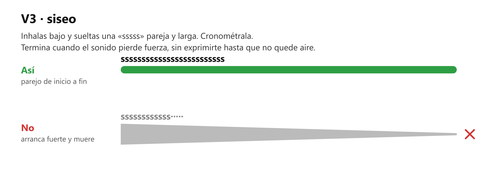
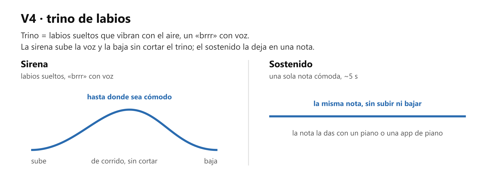
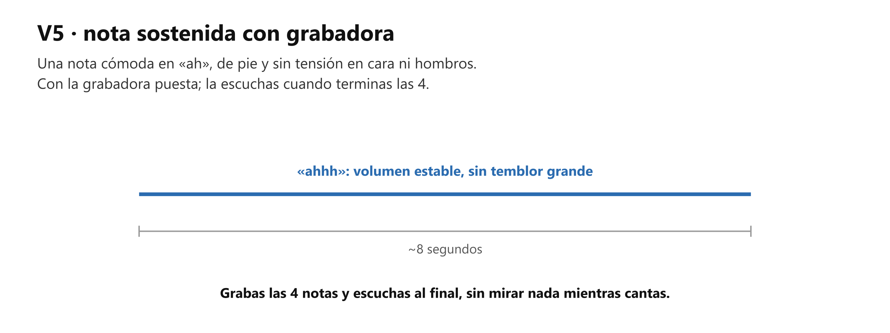

# 🎤 Práctica — Aire y trino (el calentamiento base)

> **De pie o bien sentado.** Son los ejercicios de la clase 1 de canto. Entrenan el aire y son tu calentamiento fijo antes de cantar.

## 🎯 Qué estás mejorando (en claro)

**El control de la salida del aire**, la base de lo demás. Sin aire parejo no hay nota sostenida, no hay afinación estable y no hay frase completa: la voz tiembla, se corta o se queda sin aire a media frase.

Los ejercicios usan dos sonidos. El **siseo** es una «sssss» pareja y larga. El **trino de labios** es un «brrr» con voz, con los labios sueltos; la **sirena** es ese trino subiendo la voz hasta donde sea cómodo y bajando, de corrido.

**Lo vas a notar** cuando el siseo y el trino duren más semana a semana sin esfuerzo, y cuando cantar una frase larga deje de sentirse como llegar ahogado al final.

## Cómo se hace (referencia)

**Si algo duele o raspa, para.** El cansancio en el abdomen está bien; el dolor en la garganta, nunca.

## ⏱️ Los 3 niveles del día — elige según cómo amaneciste

**Pon cronómetro. Cuando suena, paras.** Cada nivel incluye al anterior.

### 🔵 Mínimo — 5 min (día sin ganas; hecho esto, CUMPLISTE)

| Qué | Cuánto |
|---|---|
| V1, manos puestas | 4 respiraciones lentas (~1 min) |
| V2, buscando 5 s o más en cada intento | 4 intentos (~2 min) |
| V4, solo la sirena, suave | 6 sirenas (~2 min) |

Sin grabadora y sin metrónomo.

### 🟢 Natural — 10 min (el día normal)

Todo el Mínimo, y además:

| Qué | Cuánto |
|---|---|
| V3, anota el mejor tiempo | 4 siseos (~2.5 min) |
| V2, buscando 10 s o más | 3 intentos (~1.5 min) |
| V4, solo el sostenido, en la misma nota | 4 trinos de ~5 s (~1 min) |

### 🔥 Motivado — 14 min

Todo el Natural, y además:

| Qué | Cuánto |
|---|---|
| V5, con grabadora; escúchala al final | 4 notas de ~8 s (~2.5 min) |
| V4, solo la sirena, más amplia: hasta el borde cómodo, sin empujar | 6 sirenas (~1.5 min) |

## Cómo suena cuando está bien

- El siseo es parejo de inicio a fin, no arranca fuerte y muere.
- El trino no se corta a mitad de sirena: si vibra continuo, tu aire es continuo.
- En la grabación de la nota en «ah»: volumen estable, sin temblor grande, y tu cara y tus hombros (si te ves en un espejo) sin tensión.

## Si sale mal — los 3 típicos

| Pasa esto | Casi siempre es | Arréglalo así |
|---|---|---|
| **Los hombros suben al inhalar** | El hábito viejo de respiración alta (el aire llega solo al pecho) | Hazlo sentado frente a un espejo, o acuéstate con un libro en el abdomen: acostado, la respiración baja sale sola. Luego, de pie, repite esa sensación |
| **El trino se corta o no arranca** | Labios apretados o aire a golpes | Suelta más los labios y las mejillas (puedes sostener las mejillas con los dedos). Piensa en empujar el aire desde el abdomen, parejo, no en hacer sonar los labios |
| **Mareo ligero** | Hiperventilación: más aire del que gastas | Es común al inicio. Pausa, respira normal 30 s y sigue. Baja el número de respiraciones seguidas |

## Hasta cuándo / cuándo ya está

Este no se retira: es el calentamiento permanente (sección 1.5 del mapa). Los objetivos del módulo (evaluación de M1): siseo parejo de 20 s o más, nota cómoda sostenida 8 s estable y sin tensión visible. Cuando eso salga, el ejercicio sigue, pero como calentamiento de 5 min y no como práctica principal.

## Qué sigue

Con la evaluación de M1 cumplida, canto M2: afinar una nota que oyes (2.1) y distinguir la voz de pecho de la voz de cabeza (2.2). Mientras tanto, el repertorio que pidió el profesor va primero en cada sesión de canto.
