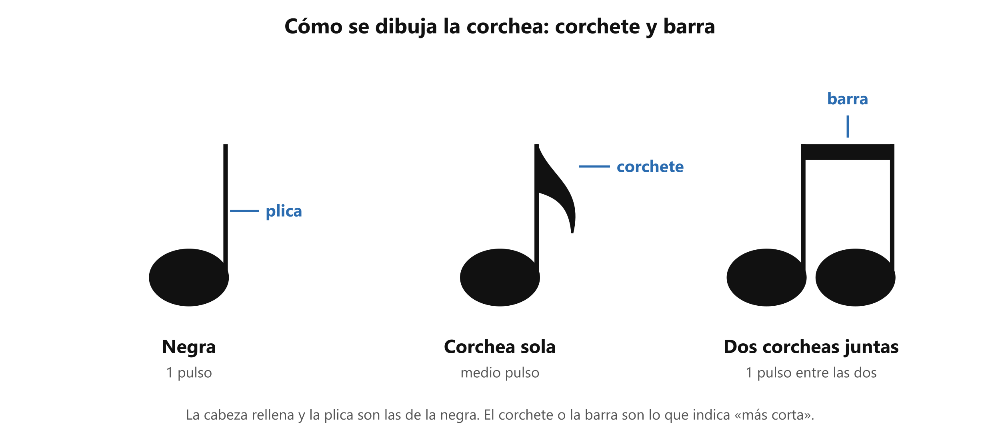
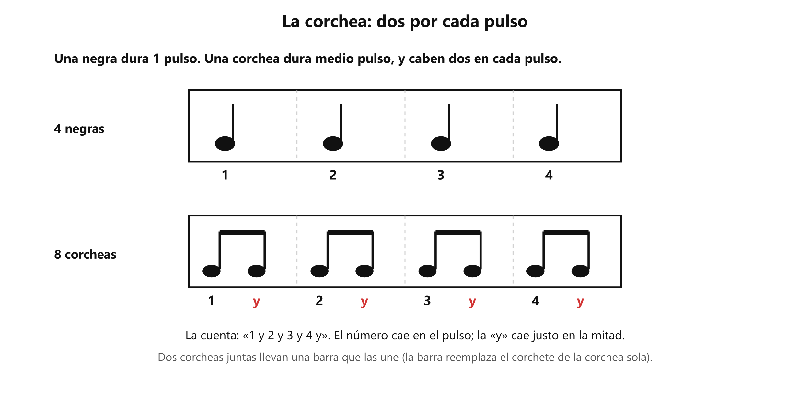

# ✂️ La corchea y la cuenta «1 y 2 y»

**Antes de esto necesitas:** [Las figuras rítmicas: redonda, blanca y negra](clase04_figuras.md)

> **La corchea es la figura que dura medio pulso: caben dos en cada pulso.** Sirve para las sílabas que van más rápido que el pulso, y para contarlas se usa la «y».

## Por qué hace falta una figura más corta

Con la negra, la sílaba más rápida dura un pulso entero. Pero en muchas canciones hay sílabas que van más seguidas que el pulso: dos sílabas dentro de un mismo pulso. Para escribirlas hace falta una figura más corta.

Esa figura es la **corchea**. Dura **medio pulso**, la mitad de una negra. Dividir cada pulso en dos partes iguales se llama **subdivisión**.

## Cómo se dibuja

La corchea tiene la cabeza rellena y una plica, igual que la negra, pero con un **corchete**: un rabito curvo en la punta de la plica. Cuando hay dos o más corcheas seguidas, el corchete se reemplaza por una **barra** que une las plicas.

Por eso, de un vistazo: una negra tiene solo plica; una corchea sola tiene plica y corchete; dos corcheas juntas se unen por una barra.

*De la negra a la corchea: el corchete (corchea sola) o la barra (dos o más juntas) indican que la figura es más corta.*

## La cuenta «1 y 2 y 3 y 4 y»

Para contar las corcheas se agrega una **«y»** entre pulso y pulso. El número cae exactamente sobre el pulso, y la «y» cae justo en la mitad entre ese pulso y el siguiente.

Un compás de 4/4 lleno de corcheas tiene 8: se cuenta **1 y 2 y 3 y 4 y**.

*Arriba, cuatro negras: un sonido por pulso. Abajo, ocho corcheas: dos por pulso, con la «y» en rojo.*

Dos corcheas siempre valen una negra: ½ + ½ = 1. Por eso se pueden mezclar con las demás figuras mientras el compás sume 4. Por ejemplo, negra + dos corcheas + negra + negra = 1 + ½ + ½ + 1 + 1 = 4, que se cuenta **1 · 2 y · 3 · 4**.

## La corchea en la voz

Cada pulso ahora puede llevar una o dos sílabas.

- Una palabra de dos sílabas rápidas dentro de un pulso: *pa-ta*, contada **1 y**.
- Una frase mezclada: *a-le* en dos corcheas (pulso 1), *lu* en una negra (pulso 2), *ya* en una blanca (pulsos 3 y 4). Se cuenta **1 y · 2 · 3 · 4**.

Una forma de comprobarlo: aplaude el pulso y di *pa-ta, pa-ta, pa-ta, pa-ta* con las dos sílabas dentro de cada palmada. La primera sílaba cae sobre la palmada y la segunda en el punto medio.

> 📋 **Repaso en una pantalla**
> - **Corchea** = **medio pulso**; caben **dos por pulso**. Valen la mitad de una negra.
> - **Subdivisión** = dividir cada pulso en partes iguales (aquí, en dos).
> - Una corchea sola lleva **corchete**; dos o más seguidas se unen con una **barra**.
> - La cuenta es **1 y 2 y 3 y 4 y**: el número cae en el pulso, la «y» en la mitad.
> - Dos corcheas = una negra. Cada compás de 4/4 sigue sumando 4 pulsos.

---
[← Las figuras](clase04_figuras.md) · [índice](../../00_indice.md) · siguiente: [Los silencios](clase04_silencios.md)
