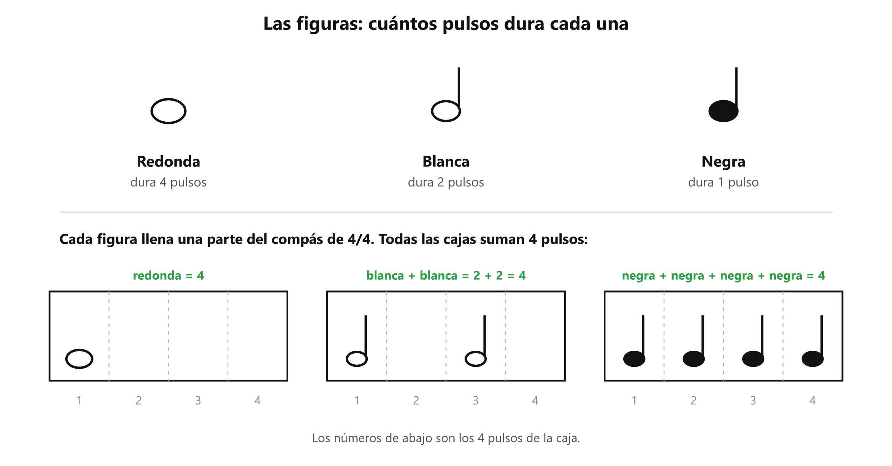

# 🎼 Las figuras rítmicas: redonda, blanca y negra

**Antes de esto necesitas:** [El pulso, el metrónomo y el compás de 4/4](clase04_pulso-y-compas.md)

> **Una figura es el símbolo que dice cuánto dura un sonido, contado en pulsos.** Con ellas se escribe el ritmo de una canción: cuántos pulsos se sostiene cada sílaba.

## Las tres primeras figuras

Cada figura se dibuja con una **cabeza** (el óvalo) y, en algunas, una **plica** (el palito vertical). Se distinguen por dos cosas: si la cabeza está hueca o rellena, y si lleva plica.

| Figura | Cómo se dibuja | Dura |
|---|---|---|
| **Redonda** | Óvalo hueco, sin plica | **4 pulsos** |
| **Blanca** | Óvalo hueco, con plica | **2 pulsos** |
| **Negra** | Óvalo relleno, con plica | **1 pulso** |

Cada figura dura la mitad que la anterior: dos blancas llenan lo que una redonda, y dos negras lo que una blanca.

## El compás de 4/4, completo

El 4/4 que se vio en [el apunte del pulso](clase04_pulso-y-compas.md) tiene un segundo número, el de abajo. Dice **qué figura vale un pulso**: el 4 de abajo significa "la negra". Por eso el 4/4 se lee: *cajas de 4 pulsos, donde cada negra ocupa uno*.

Cada caja tiene que sumar exactamente 4 pulsos. Se puede llenar de varias maneras:

- una redonda: 4
- dos blancas: 2 + 2 = 4
- cuatro negras: 1 + 1 + 1 + 1 = 4
- mezclas: negra + negra + blanca = 1 + 1 + 2 = 4

*Arriba, las tres figuras. Abajo, tres maneras de llenar un compás de 4/4. Los números 1 a 4 son los pulsos de la caja.*

## Las figuras en la voz

Cada sílaba tiene su figura, y la figura dice cuánto se sostiene la voz en esa sílaba.

- **Cuatro negras:** *a-le-lu-ya*, una sílaba por pulso.
- **Dos blancas:** *Glo-ria*, cada sílaba se sostiene dos pulsos. Se oye más lenta y más cantada.
- **Una redonda:** una sola sílaba sostenida los cuatro pulsos de un compás, como el final de una frase larga.

Una forma de comprobarlo: aplaude el pulso y di *a-le-lu-ya* con una sílaba por palmada. Luego di *Glo-ria* alargando cada sílaba hasta la tercera palmada y empezando la siguiente en ella. Se nota cómo la misma palabra cambia al cambiar la figura.

> 📋 **Repaso en una pantalla**
> - **Figura** = símbolo que dice cuántos pulsos dura un sonido.
> - **Redonda** (óvalo hueco, sin plica) = **4 pulsos**. **Blanca** (hueca, con plica) = **2**. **Negra** (rellena, con plica) = **1**.
> - Cada figura dura la mitad que la anterior.
> - **4/4:** arriba = 4 pulsos por caja; abajo = la negra vale 1 pulso. Cada caja suma exactamente 4.
> - En la voz, la figura de una sílaba dice cuánto la sostienes.

---
[← El pulso y el compás](clase04_pulso-y-compas.md) · [índice](../../00_indice.md) · siguiente: [La corchea](clase04_corchea.md)
