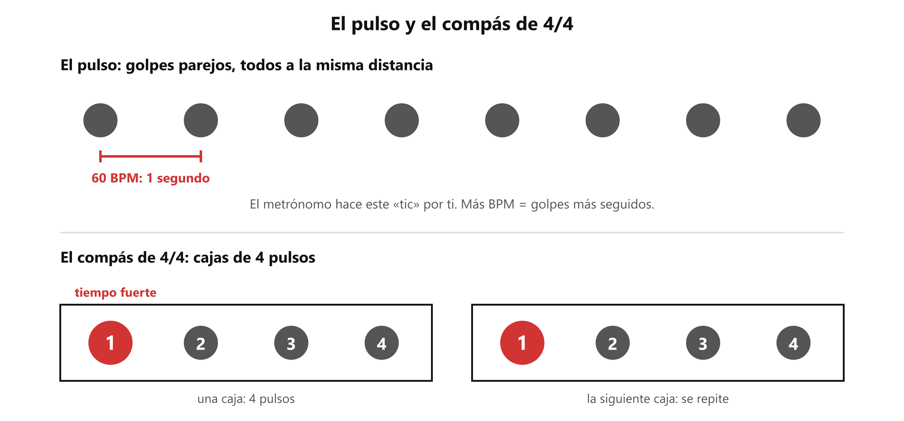
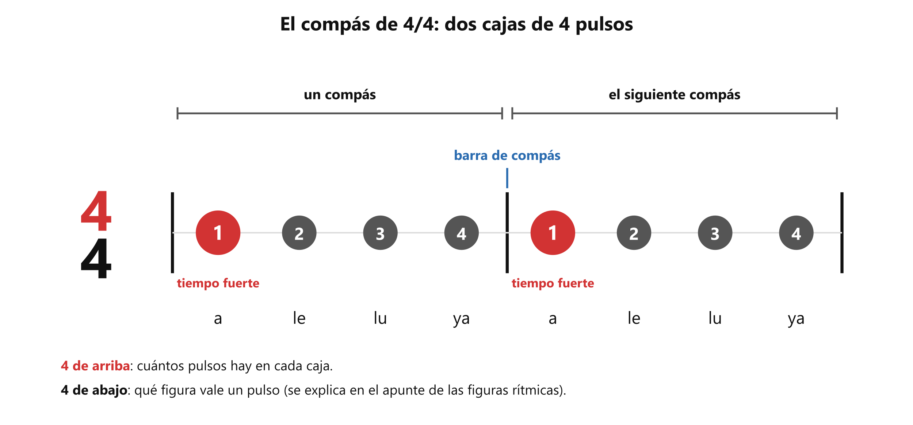
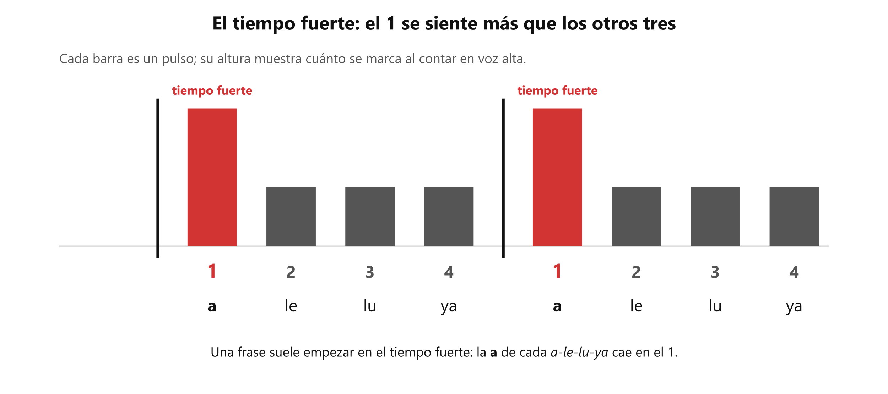

# 🥁 El pulso, el metrónomo y el compás de 4/4

**Antes de esto necesitas:** nada: es el punto de partida.

> **El pulso es el latido parejo de una canción: golpes a la misma distancia, sin acelerar ni frenar.** Es lo primero que se entiende del ritmo, porque cantar es poner sílabas sobre ese latido.

## El pulso

Cuando alguien escucha una canción y mueve el pie o aplaude sin pensarlo, lo que marca es el **pulso**. Se reconoce porque es siempre igual: el golpe número 50 llega a la misma distancia que el golpe número 2.

El pulso no es lo mismo que las sílabas de la letra. Una **sílaba** es cada golpe de voz de una palabra: *a-le-lu-ya* tiene cuatro. Las sílabas pueden ir más rápido que el pulso, más lento o dejar de sonar un rato. El pulso sigue igual por debajo. También se le llama **tiempo** ("el primer tiempo"). En estos apuntes se dice siempre *pulso*.

Una forma de comprobarlo: aplaude parejo, sin música. Eso es un pulso. Ahora di *a-le-lu-ya* con una sílaba en cada palmada. Las cuatro sílabas caen sobre cuatro pulsos.

## La velocidad: tempo y BPM

El **tempo** es cuántos pulsos hay en un minuto. Se mide en **BPM**, que son las siglas de *beats per minute* (pulsos por minuto).

- **60 BPM** son 60 pulsos por minuto, es decir, **un pulso por segundo**.
- **120 BPM** son dos pulsos por segundo.
- Más BPM significa pulsos más seguidos, o sea, más rápido. Menos BPM, más lento.

Cada canción tiene su tempo. El número solo dice qué tan seguido late la canción: a 70 BPM caen 70 pulsos por minuto y a 110, 110. El pulso es igual de parejo en las dos, solo que en la segunda los golpes llegan más seguidos.

## El metrónomo

El **metrónomo** es un aparato, o una aplicación gratuita en el celular, que hace un clic parejo a los BPM que elijas. Es un pulso que se puede oír desde afuera.

*Arriba, el pulso: a 60 BPM cada golpe llega un segundo después del anterior. Abajo, el compás de 4/4.*

Para qué sirve: para comprobar si tu pulso es parejo. Con el metrónomo en 60 BPM, cada clic es un pulso. Si tu palmada cae encima del clic, tu pulso va con él. Si se adelanta o se atrasa, se nota enseguida.

Se usa para calibrar y después se suelta. Primero se ajusta el pulso con el clic, luego se apaga y se repite lo mismo sin él. Si el pulso se mantiene parejo, ya lo llevas por dentro; si se desarma, hace falta volver a calibrar.

## El compás: la caja de pulsos

Contar los pulsos de una canción sin parar no es práctico, así que la música los agrupa en cajas iguales. Cada caja se llama **compás**, y una línea vertical (la **barra de compás**) separa una de otra.

El **4/4** es el compás más común. Son dos números, uno sobre el otro:

- **El de arriba** dice cuántos pulsos hay en cada caja. Aquí son **4**.
- **El de abajo** dice qué figura vale un pulso. Eso necesita saber qué es una figura y se explica en [Las figuras rítmicas](clase04_figuras.md).

Entonces cada compás de 4/4 se cuenta **1-2-3-4**, y vuelve a empezar en 1: *1-2-3-4, 1-2-3-4*.

*Dos compases de 4/4. El 4 de arriba cuenta los pulsos de la caja; la barra de compás marca dónde termina una y empieza la siguiente.*

### El tiempo fuerte

El primer pulso de cada compás es el **tiempo fuerte**: el que más se siente y donde suelen caer los comienzos de frase (una **frase** es un grupo de sílabas que se cantan seguidas y forman una idea, como un verso). Al contar en voz alta, el 1 sale un poco más marcado que el 2, el 3 y el 4.

Prueba con *a-le-lu-ya* repetido: cuatro sílabas, cuatro pulsos, una caja. La *a* cae en el tiempo fuerte. Al repetirlo, *a-le-lu-ya, a-le-lu-ya*, empieza el siguiente compás.

*El tiempo fuerte es el pulso 1 de cada compás: el que más se marca.*

> 📋 **Repaso en una pantalla**
> - **Pulso** = el latido parejo de una canción. También se dice *tiempo*.
> - **Sílaba** = cada golpe de voz de una palabra. Las sílabas van sobre el pulso, pero no son el pulso.
> - **Tempo** = pulsos por minuto, en **BPM**. 60 BPM = un pulso por segundo.
> - **Metrónomo** = clic parejo a los BPM que eliges. Se usa para calibrar el pulso y después se suelta.
> - **Compás** = caja de pulsos, separada por la barra de compás. En **4/4** hay 4 pulsos por caja.
> - **Tiempo fuerte** = el 1, el primer pulso de cada compás.

---
[índice](../../00_indice.md) · siguiente: [Las figuras rítmicas](clase04_figuras.md)
