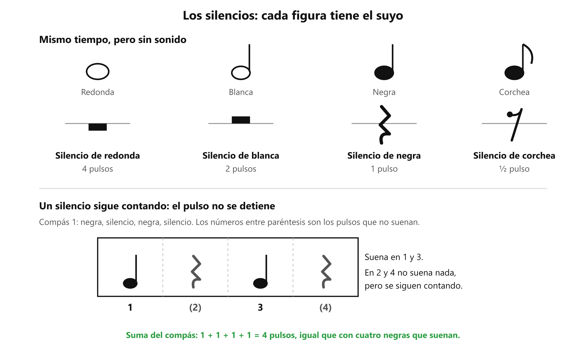

# 🤫 Los silencios

**Antes de esto necesitas:** [Las figuras rítmicas](clase04_figuras.md) · [La corchea y la cuenta «1 y 2 y»](clase04_corchea.md)

> **Un silencio es la señal de un pulso, o de una parte de pulso, en que no suena nada, y dura exactamente lo que dura la figura de su mismo nombre.** El pulso sigue contando por dentro: lo único que cambia es que no cantas.

## Un silencio por cada figura

Cada figura tiene su silencio. Dura lo mismo que ella, pero se escribe con otro dibujo. Los dos rectángulos se dibujan sobre una línea del **pentagrama**, que son las cinco líneas horizontales donde se escribe la música.

| Silencio | Cómo se dibuja | Dura |
|---|---|---|
| **De redonda** | Rectángulo negro colgado de una línea | **4 pulsos** |
| **De blanca** | Rectángulo negro apoyado sobre una línea | **2 pulsos** |
| **De negra** | Línea quebrada en zigzag | **1 pulso** |
| **De corchea** | Parecido a un 7, con un punto arriba a la izquierda | **½ pulso** |

El de redonda y el de blanca se parecen: la diferencia es que uno cuelga y el otro se apoya.

*Arriba, cada figura con su silencio y su duración. Abajo, un compás: suena en los pulsos 1 y 3, y los pulsos 2 y 4 son silencio.*

## El pulso no se detiene

Un silencio no es un descanso libre: el pulso sigue, y se cuenta por dentro. Si un compás es *negra, silencio de negra, negra, silencio de negra*, se cuenta **1-2-3-4** completo, pero solo suena en el 1 y en el 3. En el 2 y en el 4 no se canta nada y se sigue contando.

Los pulsos sin sonido suman igual que los demás. El compás de ese ejemplo suma 1 + 1 + 1 + 1 = 4, igual que cuatro negras que suenan.

Si el silencio no se cuenta, lo que viene después entra tarde. Por eso, al aprender un ritmo con silencios, se cuentan en voz alta, aunque no suenen, y después por dentro.

## Para qué sirven en una canción

- **Separar frases.** El silencio marca dónde termina una frase y empieza otra.
- **Tomar aire.** Es el momento natural para respirar, sin perder el pulso. Una frase larga sin silencio no deja dónde respirar.
- **Dar forma al ritmo.** Un silencio entre dos sílabas cambia cómo se oye la frase.

## El silencio de corchea

Dura medio pulso, la mitad de un silencio de negra. Se cuenta con la misma cuenta de las corcheas: en **1 y 2 y**, el silencio de corchea cubre la mitad que no suena, ya sea el número o la «y». Las dos mitades de un pulso pueden ser corchea y silencio de corchea, en cualquier orden.
Una forma de comprobarlo: aplaude el pulso, di *a* en la palmada 1 y *le* en la 3; en la 2 y en la 4 no digas nada y cuenta en voz baja *2* y *4*. El silencio se oye mejor cuando el pulso por debajo sigue parejo.

> 📋 **Repaso en una pantalla**
> - **Silencio** = un pulso, o parte de uno, sin sonido. Dura lo que la figura de su mismo nombre.
> - **De redonda** = 4 pulsos (rectángulo colgado). **De blanca** = 2 (rectángulo apoyado). **De negra** = 1 (zigzag). **De corchea** = ½ (como un 7 con punto).
> - El **pulso sigue contando** por dentro durante el silencio.
> - Cada compás de 4/4 suma 4 pulsos, suenen o no.
> - Sirven para separar frases, tomar aire y dar forma al ritmo.

---
[← La corchea](clase04_corchea.md) · [índice](../../00_indice.md) · siguiente: [El contratiempo](../clase06/clase06_contratiempo.md)
