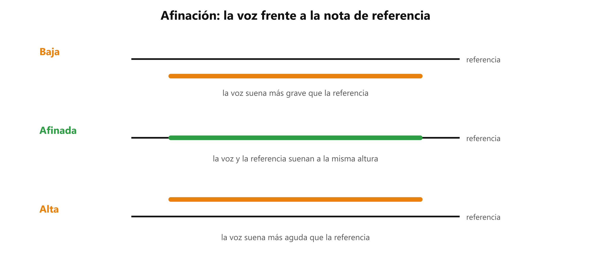

# 🎯 Afinación: cantar la altura que oyes

**Antes de esto necesitas:** [Las notas y las octavas](clase05_notas-y-octavas.md) · [El semitono](clase05_semitono.md) · [Respirar para cantar](../clase01/clase01_respiracion.md)

> **Cantar afinado es que tu voz suene a la misma altura que la nota de referencia.** Se entrena con el oído: oír la nota, cantarla y comprobar si coincide.

## Qué es estar afinado

Una **nota de referencia** es una nota que suena afuera de ti, de un piano o un teclado, y que sirve de modelo. Estás **afinado** cuando tu voz suena a la misma altura que ella. Cuando las dos suenan a la vez, se oyen como un solo sonido: se *funden*.

Hay dos maneras de salirse:

- **Baja:** tu voz suena más grave que la referencia.
- **Alta:** tu voz suena más aguda que la referencia.

*La línea negra es la nota de referencia. La línea de color es tu voz.*

A veces la diferencia es menor a un semitono ([El semitono](clase05_semitono.md)) y igual se oye mal.

## Cómo se entrena

El procedimiento es siempre el mismo, con tres pasos:

1. **Oír** la nota de referencia hasta tenerla clara.
2. **Cantarla**.
3. **Volver a oír** la referencia y comparar: ¿era más alta o más baja que la mía?

La referencia la da un piano, un teclado o una aplicación de piano. Una aplicación que dibuje la altura de tu voz mientras cantas hace el trabajo que debe hacer el oído, y entonces el oído no se entrena. La comprobación se hace después: se canta sin mirar nada, se graba y se escucha la grabación.

Una nota que sale **baja** con frecuencia tiene que ver con el apoyo del aire, que se explica en [Respirar para cantar](../clase01/clase01_respiracion.md). Qué causa una nota baja concreta lo identifica el profesor, que oye la voz.

> 📋 **Repaso en una pantalla**
> - **Afinado** = tu voz suena a la misma altura que la nota de referencia.
> - **Baja** = más grave que la referencia. **Alta** = más aguda.
> - **Referencia** = una nota de un piano, un teclado o una aplicación de piano.
> - Entrenar = oír, cantar, volver a oír y comparar. Se verifica después, con una grabación.
> - Una nota baja suele tener que ver con el apoyo del aire; el profesor identifica la causa.

---
[← El semitono](clase05_semitono.md) · [índice](../../00_indice.md) · siguiente: [Tesitura, rango y tipos de voz](clase05_tesitura-y-rango.md)
