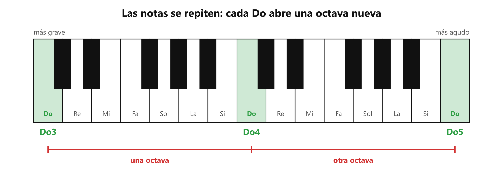

# 🎹 Las notas y las octavas

**Antes de esto necesitas:** nada: es el punto de partida.

> **Una nota es un sonido con una altura definida, y la música entera usa solo 7 nombres que se repiten de grave a agudo.** Saber dónde está una nota en ese mapa es lo que permite hablar de tu voz con precisión.

## La altura y los nombres de las notas

Los sonidos pueden ser **graves** (como una voz de hombre al hablar bajo) o **agudos** (como un silbido). Esa característica se llama **altura**: qué tan grave o agudo suena algo.

Las notas son los sonidos que usa la música, cada una con una altura fija y un nombre. Son siete, en orden de grave a agudo:

**Do · Re · Mi · Fa · Sol · La · Si**

Después de Si no aparece ninguna nota nueva: vuelve a venir **Do**, algo más agudo, y otra vez Re, Mi y así. Toda la música se hace con estas 7 notas repetidas muchas veces, más las intermedias que se verán en [El semitono](clase05_semitono.md).

## La octava

La distancia entre una nota y su repetición se llama **octava**: de un Do al siguiente Do, de un Sol al siguiente Sol. Se llama así porque, contando Do-Re-Mi-Fa-Sol-La-Si-Do, la repetición es la octava nota.

Dos sonidos separados por una octava se oyen como «la misma nota, pero más arriba». Por eso un hombre y una mujer pueden cantar la misma melodía (la secuencia de notas de una canción) juntos: él una octava más grave que ella, y suena como una sola línea.

## El teclado como mapa

Un teclado de piano muestra todas las notas en fila, de grave (izquierda) a agudo (derecha). Las teclas **blancas** llevan los 7 nombres y el patrón se repite una y otra vez. Las teclas negras se explican en el apunte del semitono.

*Cada Do verde abre una octava nueva. De un Do al siguiente están todas las notas una vez.*

## El número: en qué octava está la nota

Con solo el nombre no queda claro cuál: un Sol grave y un Sol agudo se llaman igual. Por eso cada nota lleva un **número** que dice en qué octava está: **Do3, Sol4, Mi5**. A mayor número, más agudo.

- El número cambia justo en cada **Do**. Después de Si3 viene Do4: Do3-Re3-Mi3-Fa3-Sol3-La3-Si3 → Do4.
- El **Do central** del piano es el **Do4**. Es la referencia que usa todo el mundo.
- Así se habla sin ambigüedad: no «un Sol agudo», sino **Sol4**.

Una forma de comprobarlo: en un teclado o una aplicación de piano, toca un Do y luego el Do siguiente hacia la derecha. Suenan parecido, el segundo más agudo, y entre ellos están las 7 notas.

> 📋 **Repaso en una pantalla**
> - **Altura** = qué tan grave o agudo suena un sonido.
> - 7 notas: **Do Re Mi Fa Sol La Si**, y después vuelve Do.
> - **Octava** = la distancia de una nota a su repetición (un Do al siguiente Do).
> - El **número** (Do3, Sol4) dice en qué octava está. Mayor número, más agudo. Cambia en cada Do.
> - **Do4** = el Do central del piano.

---
[índice](../../00_indice.md) · siguiente: [El semitono](clase05_semitono.md)
