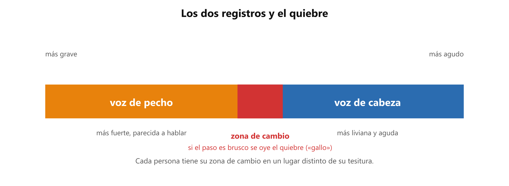

# 🔀 Registro de voz: pecho, cabeza y el quiebre

**Antes de esto necesitas:** [Tesitura, rango y tipos de voz](clase05_tesitura-y-rango.md)

> **Un registro es cada una de las dos maneras de producir el sonido: la voz de pecho para las notas más graves y la voz de cabeza para las más agudas.** Es una sola voz que funciona de dos modos.

## Los dos registros

- **Voz de pecho:** más grave, con más cuerpo. Se parece a la voz con la que hablas fuerte o llamas a alguien. Se siente vibrar el pecho.
- **Voz de cabeza:** más aguda y más liviana. Se siente la vibración más arriba, en la cara y la cabeza.

Los dos registros no son voces distintas: son dos modos de la misma. Esta división en dos es la versión inicial: hay otras formas de producir la voz que se verán más adelante. Cada uno cubre una parte del rango y se superponen en una zona intermedia.

*Cada persona tiene su zona de cambio en un lugar distinto de su tesitura.*

## El quiebre

Al subir, tarde o temprano la voz tiene que pasar de pecho a cabeza. Si ese paso es brusco, se oye un salto: es el **quiebre**, al que también se le dice **gallo**. Es normal y se trabaja con el tiempo.

El objetivo es pasar de un registro a otro sin que se note el corte. Se practica con una **sirena**: un ejercicio donde la voz sube y baja deslizando, sin cortes, como la sirena de una ambulancia, sobre una sola vocal. La sirena pasa por la zona de cambio muchas veces y enseña al cuerpo a hacer el paso suave.

## Lo que un apunte no puede decir

Cómo se siente exactamente cada registro y dónde está tu zona de cambio lo identifica el profesor, que oye tu voz. Lo que lees aquí da el nombre y el mapa; el oído del profesor da la corrección.

> 📋 **Repaso en una pantalla**
> - **Registro** = cada modo de producir la voz: **pecho** (más grave, con cuerpo) y **cabeza** (más aguda, liviana).
> - Son dos modos de la misma voz, con una zona intermedia donde se superponen.
> - **Quiebre** o **gallo** = el salto que se oye cuando el paso de uno a otro es brusco.
> - La **sirena** (deslizar la voz subiendo y bajando sin cortes) entrena el paso suave.
> - Cómo se siente cada registro lo corrige el profesor.

---
[← Tesitura, rango y tipos de voz](clase05_tesitura-y-rango.md) · [índice](../../00_indice.md) · siguiente: [Resonancia](clase05_resonancia.md)
