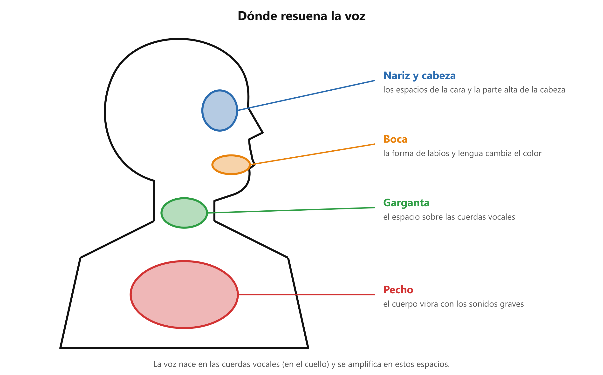

# 🔔 Resonancia: dónde suena la voz

**Antes de esto necesitas:** [Registro de voz](clase05_registro-de-voz.md) · [Respirar para cantar](../clase01/clase01_respiracion.md)

> **La resonancia es la amplificación y el color que los espacios del cuerpo le dan al sonido de las cuerdas vocales.** Por eso la voz suena más fuerte y con más cuerpo de lo que sonaría saliendo solo de la garganta.

## De dónde sale el sonido

El sonido de la voz nace en las **cuerdas vocales**: dos pliegues dentro de la **laringe**, en el cuello, que vibran cuando pasa el aire. Solo, ese sonido es débil. Se hace fuerte y reconocible al pasar por una serie de espacios huecos del cuerpo, igual que un sonido se oye más en una habitación vacía que en un armario.

Esos espacios son los **resonadores**.

*Los espacios donde resuena la voz, de arriba hacia abajo.*

- **Nariz y cabeza:** los espacios de la cara y la parte alta del cráneo. Se asocian con las notas agudas y livianas.
- **Boca:** su forma cambia con los labios, la lengua y la mandíbula. Es el resonador que más se puede mover a voluntad.
- **Garganta:** el espacio sobre las cuerdas vocales.
- **Pecho:** el torso vibra con los sonidos graves.

## Resonancia y registro

La resonancia explica por qué cada registro se siente en un lugar distinto ([Registro de voz](clase05_registro-de-voz.md)). En la voz de pecho se siente la vibración abajo, en el pecho. En la de cabeza, arriba, en la cara.

## El timbre

El **timbre** es el color de una voz: lo que hace que dos personas que cantan la misma nota suenen distinto. Depende de cómo resuena cada cuerpo. También se puede cambiar un poco: al modificar la forma de la boca cambia el espacio de resonancia y cambia el color.

Una forma de comprobarlo: pon la mano en el pecho y di «mmm» con los labios cerrados en una nota grave; luego en una aguda. El pecho vibra más en la grave. Después pon un dedo en un lado de la nariz y repite «mmm»: la vibración se siente ahí. Cómo se siente en tu voz lo confirma el profesor.

> 📋 **Repaso en una pantalla**
> - La voz nace en las **cuerdas vocales** (dentro de la laringe, en el cuello) y es débil por sí sola.
> - **Resonancia** = el sonido se amplifica y toma color en los espacios del cuerpo: nariz y cabeza, boca, garganta y pecho.
> - Pecho = vibración abajo, en las notas graves. Cabeza = vibración arriba, en las agudas.
> - **Timbre** = el color de una voz. Cambia un poco con la forma de la boca.

---
[← Registro de voz](clase05_registro-de-voz.md) · [índice](../../00_indice.md) · siguiente: [Las vocales y la gesticulación](clase05_vocales-y-gesticulacion.md)
