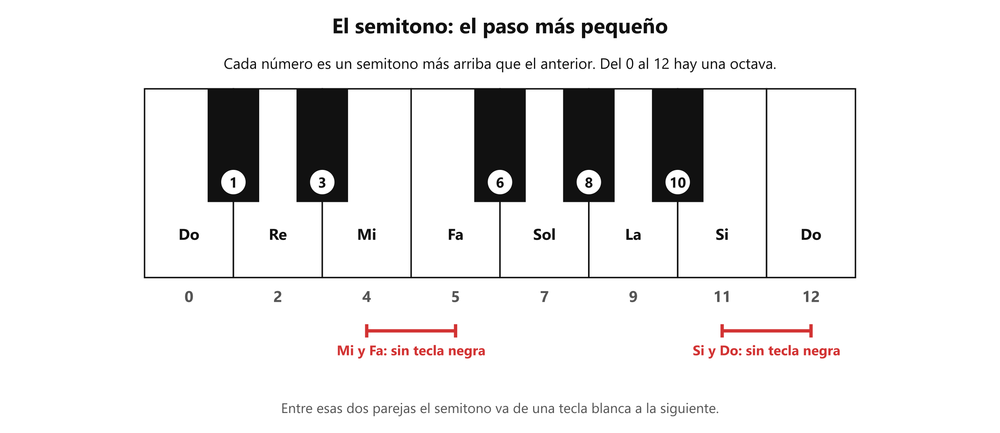

# 🪜 El semitono

**Antes de esto necesitas:** [Las notas y las octavas](clase05_notas-y-octavas.md)

> **El semitono es el paso más pequeño entre dos notas.** Es la unidad con la que se miden las distancias en la música: de una nota a otra, de una canción a otra más grave.

## El paso más pequeño

En un teclado, el semitono es la distancia de una tecla a la **tecla vecina**, sea blanca o negra. No hay ninguna tecla entre las dos.

Entre un Do y el Do siguiente hay **12 semitonos**. Eso es una octava.

*Cada número es un semitono más arriba que el anterior. Del 0 al 12 hay una octava.*

Entre algunas notas blancas hay una tecla negra y entre otras no. **Entre Mi y Fa, y entre Si y Do, no hay tecla negra**: esas dos parejas ya están a un semitono. Las demás notas blancas vecinas (Do y Re, Re y Mi, Fa y Sol, Sol y La, La y Si) están a dos semitonos, con una tecla negra en medio.

## Sostenido y bemol

Las teclas negras son las notas intermedias. Se nombran a partir de la blanca más cercana:

- **Sostenido** (**#**) sube un semitono. La tecla negra a la derecha de Do es **Do#**.
- **Bemol** (**b**) baja un semitono. La misma tecla negra, vista desde Re, es **Reb**.

Una tecla negra tiene entonces dos nombres: Do# y Reb son el mismo sonido.

## Para qué sirve contar semitonos

Sirve para medir con exactitud una distancia. «Bajar una canción 3 semitonos» significa mover cada nota de la canción 3 teclas a la izquierda, contando también las negras. Por ejemplo, un Mi bajado 3 semitonos es un Do#: Mi → Re# → Re → Do#.

Así se pueden dar instrucciones precisas: «sube 2 semitonos», «baja 5».

> 📋 **Repaso en una pantalla**
> - **Semitono** = el paso más pequeño: de una tecla a la tecla vecina, blanca o negra.
> - **12 semitonos** = una octava.
> - **Mi-Fa** y **Si-Do** están a un semitono (no hay tecla negra entre ellas). Las otras parejas vecinas, a dos.
> - **Sostenido (#)** sube un semitono. **Bemol (b)** baja un semitono. Do# y Reb son el mismo sonido.
> - Con semitonos se mide cuánto se baja o sube una canción.

---
[← Las notas y las octavas](clase05_notas-y-octavas.md) · [índice](../../00_indice.md) · siguiente: [Afinación](clase05_afinacion.md)
