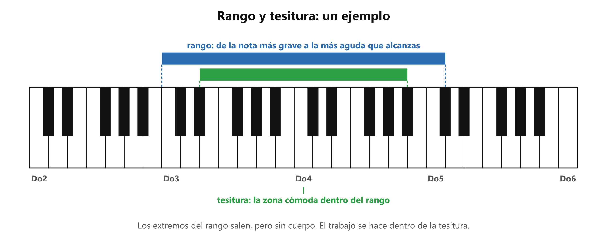

# 🧭 Tesitura, rango y tipos de voz

**Antes de esto necesitas:** [Las notas y las octavas](clase05_notas-y-octavas.md) · [El semitono](clase05_semitono.md)

> **El rango es todo lo que tu voz alcanza; la tesitura es la parte de ese rango donde suena bien.** Saber la tuya dice qué canciones te quedan cómodas y cuáles hay que mover.

## El rango

Tu voz llega hasta una nota grave y hasta una nota aguda. Todas las notas entre esas dos forman tu **rango vocal**. Se escribe con las notas de [el apunte de las notas](clase05_notas-y-octavas.md): por ejemplo, «de Do3 a Do5».

## La tesitura

Dentro del rango no todas las notas suenan igual. Cerca de los extremos las notas salen, pero con esfuerzo o sin cuerpo: se pueden producir, pero no se les pide una canción. La zona donde la voz suena con cuerpo y sin esfuerzo se llama **tesitura**.

*El ejemplo de la figura es solo un ejemplo: cada persona tiene su rango y su tesitura.*

La tesitura es la zona con la que se trabaja. Una canción te queda cómoda cuando todas sus notas caen dentro de tu tesitura. Si no caen, la canción se puede cantar más grave o más aguda que como la grabó el artista, hasta que quepa.

El rango y la tesitura cambian con el tiempo: con práctica el rango crece y la tesitura se mueve con él.

## Los tipos de voz

Las voces se clasifican según dónde queda su tesitura. De más grave a más aguda:

| | Voz masculina | Voz femenina |
|---|---|---|
| Más grave | **Bajo** | **Contralto** |
| Intermedia | **Barítono** | **Mezzosoprano** |
| Más aguda | **Tenor** | **Soprano** |

Cada tipo tiene un rango típico en voces entrenadas:

| Tipo | Rango típico |
|---|---|
| Bajo | Mi2 a Mi4 |
| Barítono | La2 a La4 |
| Tenor | Do3 a Do5 |
| Contralto | Fa3 a Fa5 |
| Mezzosoprano | La3 a La5 |
| Soprano | Do4 a Do6 |

Son referencias, y varían de una persona a otra. Una voz sin entrenar suele tener un rango más corto que el de la tabla. Un tipo de voz no mide nivel ni calidad: describe dónde está la tesitura. Sirve para saber qué tonos le quedan bien a cada voz.

> 📋 **Repaso en una pantalla**
> - **Rango** = de tu nota más grave a tu más aguda.
> - **Tesitura** = la zona del rango donde suenas con cuerpo y sin esfuerzo. Es la zona de trabajo.
> - Los extremos del rango salen, pero no se le piden a una canción.
> - Una canción cómoda tiene todas sus notas dentro de tu tesitura.
> - Voces de grave a aguda: bajo, barítono, tenor · contralto, mezzosoprano, soprano.

---
[← Afinación](clase05_afinacion.md) · [índice](../../00_indice.md) · siguiente: [Registro de voz](clase05_registro-de-voz.md)
