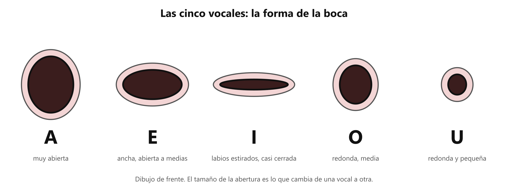

# 👄 Las vocales y la gesticulación

**Antes de esto necesitas:** [Resonancia](clase05_resonancia.md)

> **Gesticular es mover los labios, la mandíbula y las mejillas con amplitud al cantar, para que cada vocal tenga su forma de boca clara.** Al hablar la boca se mueve poco, y al cantar eso no alcanza.

## Cada vocal tiene su forma de boca

Las cinco vocales (A, E, I, O, U) se distinguen por la forma de la boca y la posición de la lengua, es decir, por el espacio que el sonido atraviesa ([Resonancia](clase05_resonancia.md)). Cambiar la forma de la boca cambia el color de la voz sin cambiar la nota.

*El tamaño y la forma de la abertura es lo que cambia de una vocal a otra.*

| Vocal | Forma de la boca |
|---|---|
| **A** | Muy abierta, la mandíbula baja |
| **E** | Ancha, abierta a medias |
| **I** | Labios estirados hacia los lados, boca casi cerrada |
| **O** | Redonda, abertura media |
| **U** | Redonda y pequeña, labios hacia adelante |

## Gesticular

**Gesticular** es moverse con amplitud entre esas formas. Al hablar, las vocales son breves y se entienden por el contexto, así que la boca apenas se mueve. Al cantar, las notas son largas y más fuertes, y una boca casi quieta deja las vocales poco claras y el sonido apagado.

Gesticular bien significa dos cosas:

- La mandíbula **baja** al abrir, sin forzarla ni empujarla hacia adelante.
- Los labios y las mejillas **acompañan** la forma de cada vocal.

La vocal I y la U tienden a cerrarse al subir a notas agudas, porque su forma ya es pequeña. Si la boca se cierra más, el sonido se aprieta. Mantener la boca bien abierta en las notas agudas es parte de gesticular. El profesor corrige cuánto abrir y dónde sobra tensión.

Una forma de comprobarlo: frente a un espejo, canta A-E-I-O-U sobre una sola nota, sin cambiarla. La boca cambia en cada vocal y la nota se queda igual.

> 📋 **Repaso en una pantalla**
> - Cada vocal tiene su **forma de boca**: A muy abierta · E ancha · I estirada y casi cerrada · O redonda media · U redonda pequeña.
> - **Gesticular** = mover labios, mandíbula y mejillas con amplitud al cantar.
> - Al cantar, la boca se mueve más que al hablar.
> - La mandíbula baja sin forzarse. I y U tienden a cerrarse en las notas agudas: mantener la boca abierta.

---
[← Resonancia](clase05_resonancia.md) · [índice](../../00_indice.md) · siguiente: [Articulación](clase05_articulacion.md)
