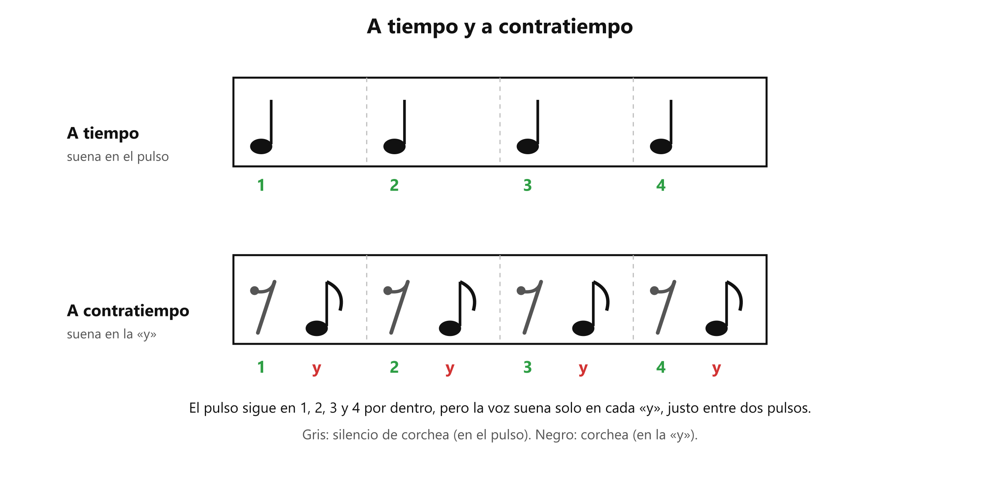

# ↪️ El contratiempo: cantar en la «y»

**Antes de esto necesitas:** [El pulso y el compás](../clase04/clase04_pulso-y-compas.md) · [Las figuras](../clase04/clase04_figuras.md) · [La corchea y la cuenta «1 y 2 y»](../clase04/clase04_corchea.md) · [Los silencios](../clase04/clase04_silencios.md)

> **Un sonido está a contratiempo cuando empieza en la «y», justo entre dos pulsos, y no sobre el pulso.** El pulso sigue sonando por dentro y la voz entra en el espacio de en medio.

## A tiempo y a contratiempo

Cantar con cada sílaba sobre el pulso (en el 1, el 2, el 3 o el 4) es cantar **a tiempo**.

Cantar **a contratiempo** es hacer lo contrario: la sílaba empieza en la **«y»**, la mitad entre un pulso y el siguiente, en el punto que se cuenta en [la corchea](../clase04/clase04_corchea.md). En el pulso no suena nada.

*Arriba, a tiempo: la voz suena en los números. Abajo, a contratiempo: la voz suena en las «y».*

## Cómo se escribe

El contratiempo se escribe con las dos figuras de medio pulso, en este orden: un **silencio de corchea** sobre el pulso y una **corchea** sobre la «y». Eso da la cuenta **(1) y (2) y (3) y (4) y**, donde los números entre paréntesis no suenan y las «y» sí.

Por eso el contratiempo depende de lo que se vio en el apunte de silencios: el pulso sigue contándose por dentro mientras no suena nada, y la voz entra justo en el medio.

## Por qué cuesta

Todo el cuerpo tiende a caer en el pulso: el pie, las palmas, la cabeza. Cantar en la «y» pide lo contrario, que el pulso exista por dentro sin sonar y la voz llegue entre dos golpes. Si el pulso interno se afloja, las sílabas se corren hacia el pulso y el contratiempo se vuelve un ritmo a tiempo sin querer.

Una forma de comprobarlo: marca el pulso con el pie (o con un metrónomo) y di «ta» solo en cada «y», entre dos golpes del pie. La sílaba tiene que caer a la mitad entre un golpe y el siguiente, sin acompañar ninguno. Si cae justo con el pie, está a tiempo.

El contratiempo también se canta con palabras: cada sílaba cae en una «y» en lugar de en un número.

> 📋 **Repaso en una pantalla**
> - **A tiempo** = el sonido empieza sobre el pulso (1, 2, 3, 4).
> - **A contratiempo** = el sonido empieza en la «y», entre dos pulsos.
> - Se escribe con un **silencio de corchea** sobre el pulso y una **corchea** en la «y».
> - El **pulso sigue** contándose por dentro mientras no suena.
> - Cuesta porque el cuerpo tiende a caer en el pulso.

---
[← Los silencios](../clase04/clase04_silencios.md) · [índice](../../00_indice.md)
