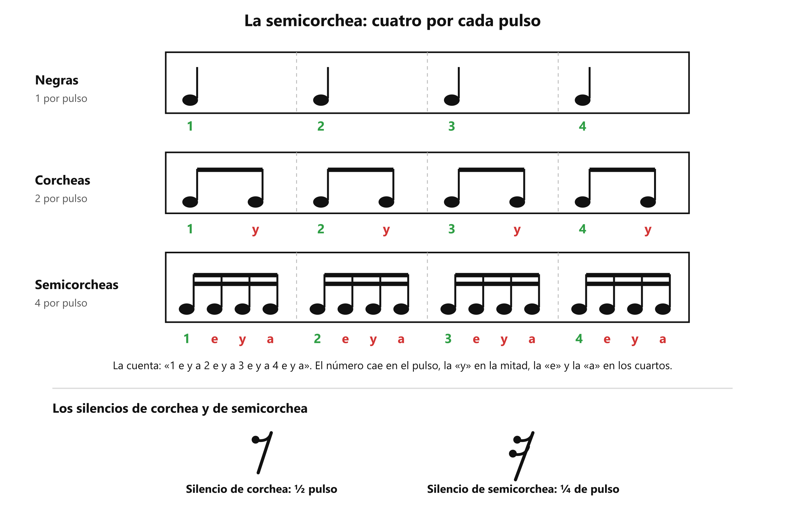
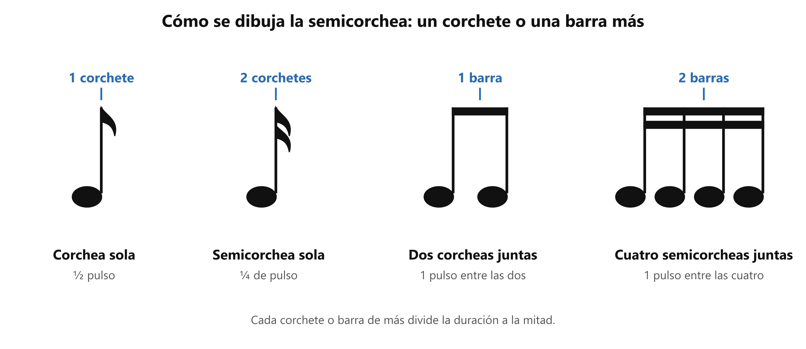

# 🔬 La semicorchea y la cuenta «1 e y a»

**Antes de esto necesitas:** [El pulso y el compás](../clase04/clase04_pulso-y-compas.md) · [La corchea y la cuenta «1 y 2 y»](../clase04/clase04_corchea.md) · [Los silencios](../clase04/clase04_silencios.md) · [Articulación](../clase05/clase05_articulacion.md)

> **La semicorchea es la figura que dura un cuarto de pulso: caben cuatro en cada pulso.** Sirve para las sílabas muy seguidas, y se cuenta con **1 e y a**.

## Un cuarto de pulso

La corchea divide el pulso en dos partes iguales. La **semicorchea** lo divide en **cuatro**, así que dura **un cuarto de pulso**, la mitad de una corchea.

Las equivalencias salen directas:

- 2 semicorcheas = 1 corchea.
- 4 semicorcheas = 1 negra, es decir, un pulso.
- En un compás de 4/4 caben **16 semicorcheas**.

*Cada fila llena el mismo compás de 4/4: cada vez más sonidos dentro de los mismos cuatro pulsos.*

## Cómo se dibuja

Tiene la cabeza rellena y la plica, como la corchea, pero con **dos** corchetes en vez de uno. Cuando hay varias seguidas, los corchetes se reemplazan por **dos barras** paralelas que unen las plicas, como se ve en la figura. Eso las distingue de las corcheas, que llevan una sola barra.

*Una semicorchea lleva un corchete o una barra más que la corchea: dos corchetes si va sola, dos barras si va unida a otras.*

## La cuenta «1 e y a»

Con cuatro sonidos por pulso hacen falta cuatro sílabas de conteo. Se cuenta **1 e y a · 2 e y a · 3 e y a · 4 e y a**:

- El **número** cae sobre el pulso.
- La **«y»** cae en la mitad del pulso, igual que en la cuenta de las corcheas.
- La **«e»** y la **«a»** caen en los cuartos que quedan: la «e» entre el número y la «y», la «a» entre la «y» y el número siguiente.

Las semicorcheas se pueden mezclar con las demás figuras mientras el compás sume 4 pulsos. Por ejemplo, una negra y cuatro semicorcheas ocupan dos pulsos: 1 + 4 × ¼ = 2.

## El silencio de semicorchea

Dura un cuarto de pulso y se dibuja como el silencio de corchea, pero con **dos** banderas en lugar de una (ver la figura). Cumple la misma función: el pulso sigue contándose por dentro mientras no suena nada.

## La semicorchea en la voz

Cada pulso puede llevar hasta cuatro sílabas. Es el ritmo de las frases rápidas, donde la articulación pesa más ([Articulación](../clase05/clase05_articulacion.md)): con cuatro sílabas dentro de un pulso, cada consonante dispone de muy poco tiempo.

Una forma de comprobarlo: marca el pulso con el pie o con un metrónomo y di *a-le-lu-ya* con las cuatro sílabas dentro de un solo golpe del pie, contando **1 e y a**. Luego repite con otras cuatro sílabas, como *pa-ra-ca-ta*, una por cada parte de la cuenta.

> 📋 **Repaso en una pantalla**
> - **Semicorchea** = **¼ de pulso**; caben **cuatro por pulso** y 16 en un compás de 4/4.
> - 2 semicorcheas = 1 corchea · 4 semicorcheas = 1 negra.
> - Se dibuja con **dos corchetes** (o **dos barras** si van unidas).
> - Cuenta: **1 e y a**. El número cae en el pulso, la «y» en la mitad, la «e» y la «a» en los cuartos.
> - **Silencio de semicorchea** = ¼ de pulso, con dos banderas. El pulso sigue contando.

---
[← Los silencios](../clase04/clase04_silencios.md) · [índice](../../00_indice.md) · siguiente: [El contratiempo](clase06_contratiempo.md)
