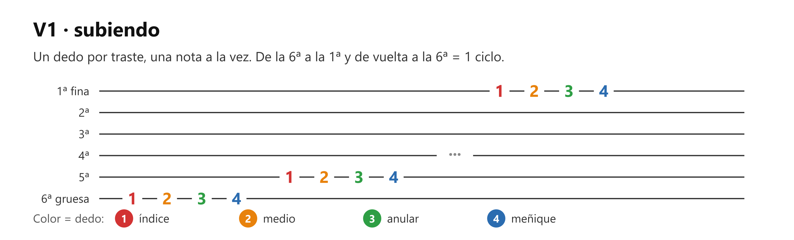
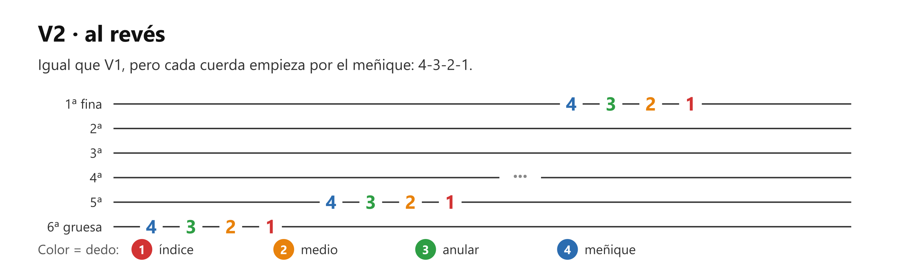
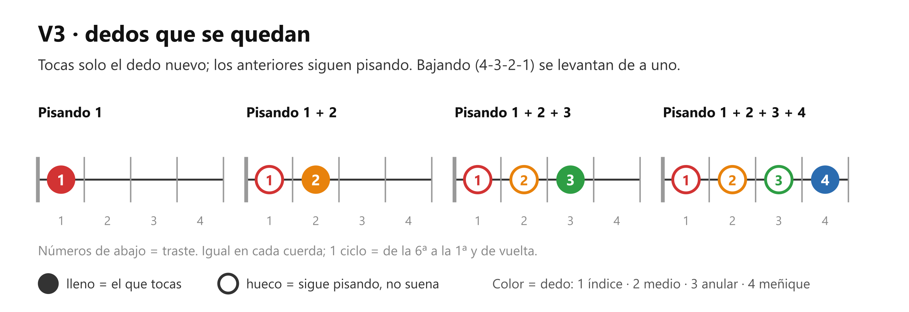
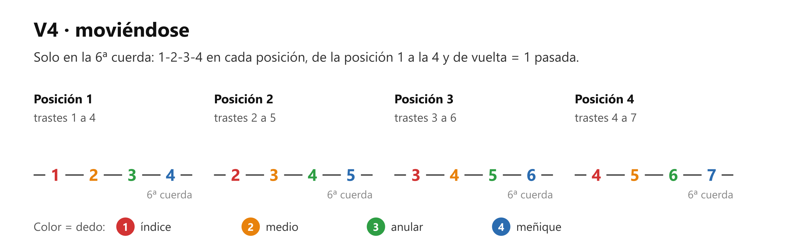
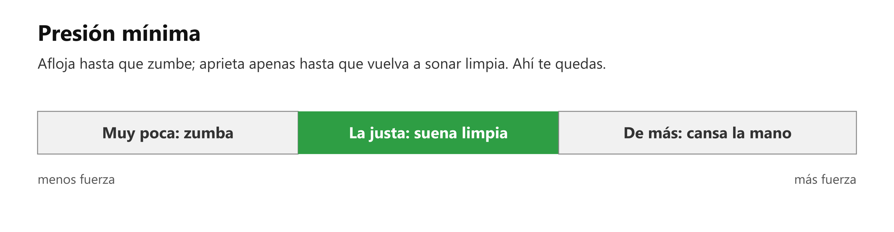

# 🎸 Práctica — El 1-2-3-4 (la "araña")

> **Con la guitarra en la mano, afinada.** Es la tarea del profesor de la clase 1. Sirve para separar los dedos que la mano tiende a mover juntos.

## 🎯 Qué estás mejorando (en claro)

Dos cosas, y las vas a poder comprobar:

1. **Que cada dedo se mueva solo.** El anular y el meñique tienden a moverse juntos: si levantas uno, el otro lo sigue. Este ejercicio los separa. Lo notarás en unas semanas, cuando armes acordes y los dedos caigan cada uno en su sitio sin recolocarlos uno por uno.
2. **Que cada nota salga limpia**, no apagada ni zumbando. Lo notarás dentro del mismo ejercicio: cada día habrá menos notas "sucias" por vuelta.

El criterio es el **sonido limpio**, no la velocidad, que llega sola después.

## Cómo se hace (referencia) — las 4 versiones

Cada imagen es una versión, escrita en [tablatura (TAB)](clase01_tablatura.md). El color del número dice qué [dedo](clase01_dedos-mano-izquierda.md) pisa.

## ⏱️ Los 3 niveles del día — elige según cómo amaneciste

**Pon cronómetro. Cuando suena, paras**, sin culpa y sin "una más". Cada nivel incluye al anterior.

### 🔵 Mínimo — 5 min (día sin ganas; hecho esto, CUMPLISTE)

| Qué | Cuánto |
| --- | --- |
| V1, lenta | 1 ciclo (~2 min) |
| V2 | 1 ciclo (~2 min) |
| Presión mínima (ver Afinación 1) | 3ª cuerda, trastes 1-2-3 con los dedos 1-2-3, una vez cada nota (~1 min) |

Sin metrónomo.

### 🟢 Natural — 12 min (el día normal)

Todo el Mínimo, y además:

| Qué | Cuánto |
| --- | --- |
| **V3** | 2 ciclos, de la 6ª a la 1ª y de vuelta (~5 min) |
| V1 con dedos cerca (ver Afinación 2) | 1 ciclo (~2 min) |

Sin metrónomo.

### 🔥 Motivado — 20 min

Todo el Natural, y además:

| Qué | Cuánto |
| --- | --- |
| V4, solo en la 6ª cuerda | 4 pasadas, de la posición 1 a la 4 y de vuelta (~1 min cada una) |
| **V1 con metrónomo a 60**, una nota por clic | ~4 min |

El [metrónomo](clase01_ritmo-basico.md) va solo en la versión que ya suena limpia sin él (hoy, V1). Cuando V1 salga pareja con metrónomo, pasa a V2.

## Cómo suena cuando está bien

- Cada nota **limpia y entera**, sin zumbido y sin sonar apagada.
- **Parejas**: la del dedo 4 suena igual de fuerte que la del dedo 1 (el meñique tiende a sonar más débil).
- A un ritmo **constante**, aunque sea lento.

## Si sale mal — los 3 típicos

| Suena así | Casi siempre es | Arréglalo así |
| --- | --- | --- |
| **Zumba o vibra** | Estás pisando lejos del traste o con poca punta | Pisa **justo detrás de la varilla de metal** del traste (no encima ni lejos de ella) y con la **punta** del dedo |
| **Suena apagada o no suena** | Un dedo vecino está rozando esa cuerda | Arquea más los dedos para que cada uno caiga de punta, como un martillito, sin tocar a los vecinos |
| **Se acelera y ensucia** | El cuerpo quiere "terminar rápido" | Baja la velocidad hasta que todas las notas suenen y quédate en esa velocidad |

## Afinación del instructor

1. **Presión mínima.** Pisa una nota y afloja el dedo hasta que empiece a zumbar; después aprieta apenas lo justo para que vuelva a sonar limpia. Esa es la presión de trabajo. Apretar de más cansa la mano y hace más lentos los cambios.

   

2. **Dedos cerca.** Los dedos que no están pisando se quedan a 1-2 cm de las cuerdas, sin levantarse lejos. Menos distancia = llegan antes a su traste.

## Hasta cuándo / cuándo ya está

Tarea de la clase 1. No se "aprueba": queda como **calentamiento de la mano izquierda** (el nivel 🔵 Mínimo, 5 min) antes de cada sesión de guitarra. **Como ejercicio está lista** cuando la V3 sale limpia dos ciclos seguidos.

## Qué sigue

Los acordes de M1 ([los 8 acordes](../clase02/clase02_los-8-acordes.md)) y el cambio de acorde de M2: los dedos que ya se mueven solos son los que caen juntos al formar un acorde.
