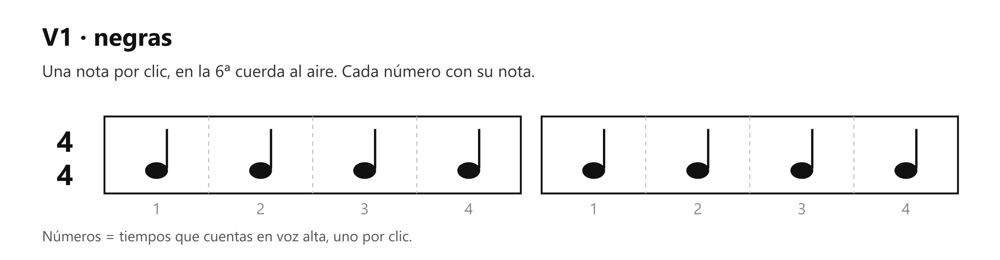
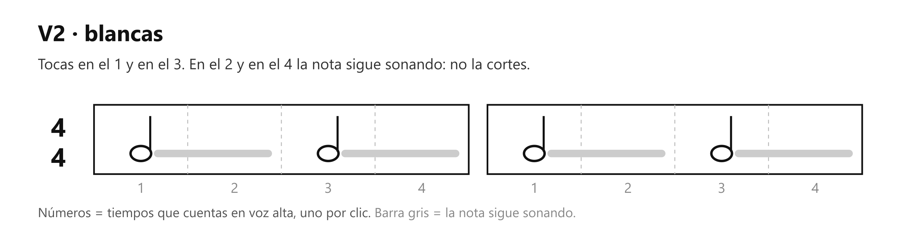
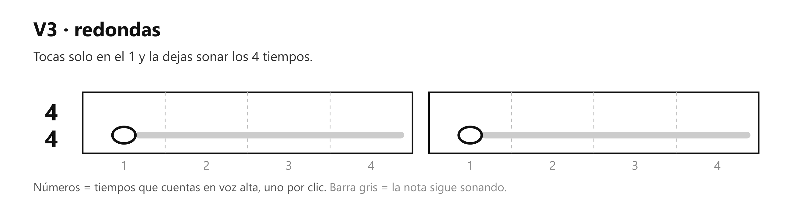
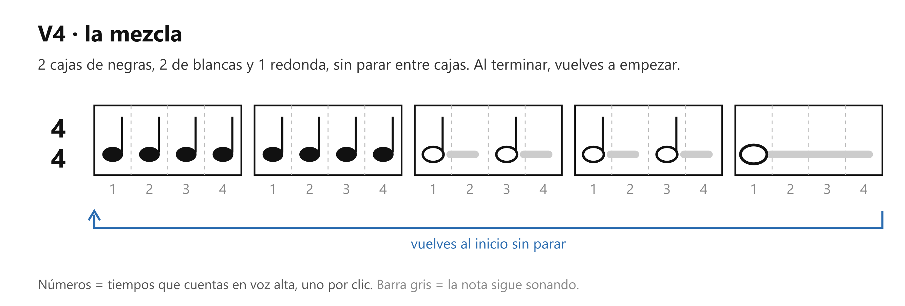
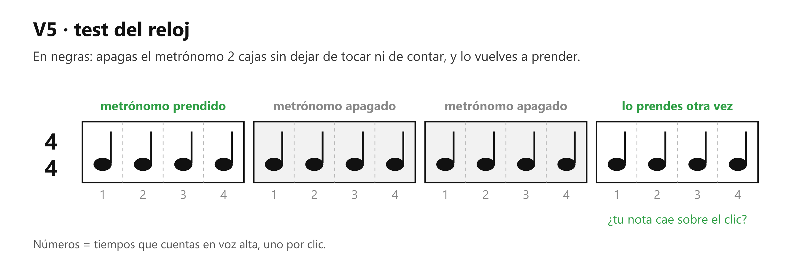

# 🎸 Práctica — Figuras con metrónomo

> **Con la guitarra afinada y el metrónomo en 60.** Es la segunda tarea de la clase 1.

## 🎯 Qué estás mejorando (en claro)

**Llevar el pulso por dentro, sin depender de la app.** Es tocar cada nota en el momento correcto, además de tocar la nota correcta. En Yousician la pista marcaba el ritmo por ti y por eso no te quedaba nada; aquí el pulso lo llevas tú.

Se toca en una sola cuerda al aire, la 6ª, porque el ejercicio es de tiempo y no de dedos. Contar en voz alta te da un punto fijo: cada número cae sobre un clic.

**Lo vas a notar** el día que apagues el metrónomo, sigas tocando, lo vuelvas a prender y sigas cuadrado con él.

## Cómo se hace (referencia)

Siempre: metrónomo en 60, la 6ª cuerda al aire y contando en voz alta 1-2-3-4. Cada imagen es una versión; las figuras están explicadas en [Ritmo básico](clase01_ritmo-basico.md).

## ⏱️ Los 3 niveles del día — elige según cómo amaneciste

**Pon cronómetro. Cuando suena, paras.** Cada nivel incluye al anterior.

### 🔵 Mínimo — 5 min (día sin ganas; hecho esto, CUMPLISTE)

| Qué | Cuánto |
|---|---|
| V1, metrónomo 60 | 2 min |
| V2, metrónomo 60 | 1 min 30 s |
| V3, metrónomo 60 | 1 min 30 s |

El metrónomo va en todos los niveles: en esta práctica, el metrónomo es el ejercicio.

### 🟢 Natural — 10 min (el día normal)

Todo el Mínimo, y además:

| Qué | Cuánto |
|---|---|
| V4, metrónomo 60 | 3 min |
| El 1-2-3-4 subiendo (la primera versión de [El 1-2-3-4](clase01_practica_independencia-1234.md)): de la 6ª a la 1ª cuerda, trastes 1-4 con los dedos 1-4, metrónomo 60, una nota por clic | 2 min |

Con el 1-2-3-4 se juntan las dos tareas de la clase 1.

### 🔥 Motivado — 15 min

Todo el Natural, y además:

| Qué | Cuánto |
|---|---|
| V5, metrónomo 60 | 3 min |
| V1, metrónomo 70 (solo si V5 te salió cuadrado; si no, V5 otra vez a 60) | 2 min |

## Cómo suena cuando está bien

Tu nota y el clic suenan tan juntos que parecen un solo sonido. Si escuchas «clic-nota» como dos cosas separadas, vas tarde (o temprano).

## Si sale mal — los 3 típicos

| Pasa esto | Casi siempre es | Arréglalo así |
|---|---|---|
| **Te adelantas al clic** | Ansiedad de «ya sé lo que viene» | No anticipes: espera a oírlo. Contar en voz alta y fuerte te ayuda a no adelantarte |
| **Te pierdes en la cuenta** | Vas más rápido de lo que tu cabeza procesa | Baja el metrónomo a 50 y practica a esa velocidad hasta que vayas cuadrado |
| **Te tensas** (hombros, mandíbula) | La concentración se vuelve rigidez | Suelta los hombros entre caja y caja. El pulso sale más parejo con el cuerpo relajado |

## Afinación del instructor

1. **Palmas, sin guitarra.** Haz V1 en cualquier momento del día con palmas y el metrónomo del celular en 60, contando en voz alta. Dos minutos en el bus sirven: el pulso se entrena también sin el instrumento.

## Hasta cuándo / cuándo ya está

Fue la tarea de la clase 1 y no se «aprueba»: se incorpora. Contar en voz alta acompaña toda práctica con ritmo hasta que el conteo salga solo, por dentro. **Está lista** cuando pasas V5, el test del reloj, en tres días seguidos de nivel Motivado.

## Qué sigue

El rasgueo (tocar varias cuerdas a la vez, barriéndolas con la mano derecha), sobre este mismo pulso: secciones 3.3 a 3.6 del temario, en M3.
