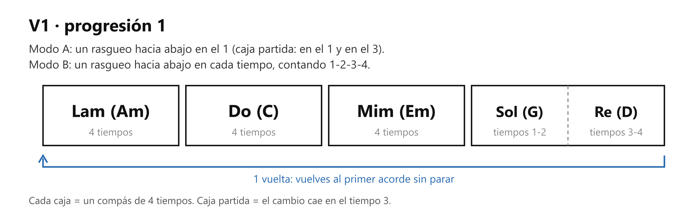
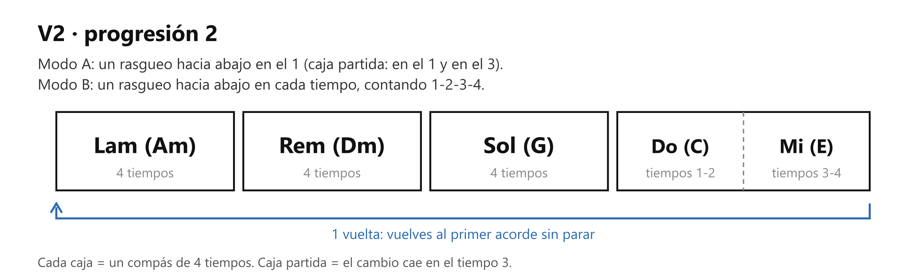
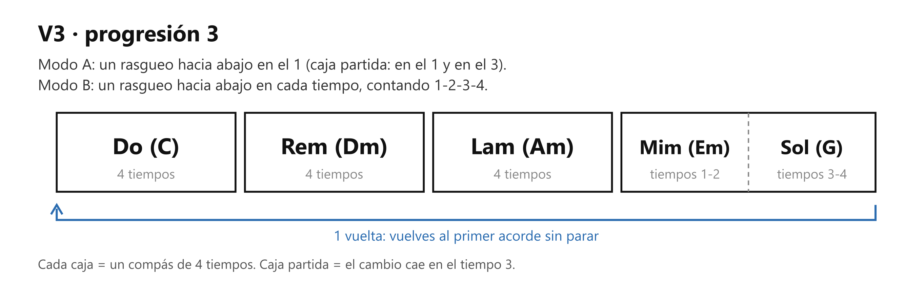
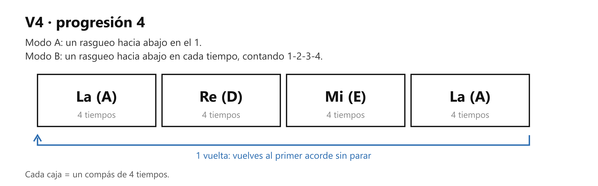

# 🎸 Práctica — Las 4 progresiones (el cambio de acorde)

> **Con la guitarra afinada.** Es la tarea de la clase 2. Una **progresión** es una secuencia de acordes que se repite en bucle. Las canciones están hechas de progresiones, así que estas cuatro entrenan los mismos cambios que vas a usar en tu repertorio.

## 🎯 Qué estás mejorando (en claro)

**La velocidad y la limpieza del cambio de acorde.** Lo que se entrena es el paso de un acorde al siguiente, que es donde un principiante se atasca y la canción pierde el pulso. En concreto: mover la menor cantidad de dedos (las anclas), no despegar toda la mano y que los dedos del acorde caigan todos a la vez.

**Lo vas a notar** cuando el cambio deje de abrir un hueco en tu conteo. Hoy, entre acorde y acorde, hay un silencio mientras buscas la forma; en unas semanas el siguiente acorde cae en su tiempo sin que el conteo se detenga.

## Cómo se hace (referencia)

Cada imagen es una progresión, de V1 a V4, con sus dos modos de rasgueo (rasguear es tocar varias cuerdas a la vez, barriéndolas con la mano derecha); las formas de los acordes están en [los 8 acordes](clase02_los-8-acordes.md).

## ⏱️ Los 3 niveles del día — elige según cómo amaneciste

**Pon cronómetro. Cuando suena, paras.** Cada nivel incluye al anterior.

### 🔵 Mínimo — 6 min (día sin ganas; hecho esto, CUMPLISTE)

| Qué | Cuánto |
| --- | --- |
| V4, modo A | 2 min, en bucle |
| V1, modo A | 3 min, en bucle |
| Cambio fantasma del par que más te trabó (ver Afinación 1) | 5 saltos (~1 min) |

Sin metrónomo, lento y contando en voz alta. Antes de cada progresión, busca sus anclas (Afinación 2).

### 🟢 Natural — 14 min (el día normal)

Todo el Mínimo, y además:

| Qué | Cuánto |
| --- | --- |
| V2, modo A | 2 min 30 s, en bucle |
| V3, modo A | 2 min 30 s, en bucle |
| V1, modo B, metrónomo 60 | 3 min (unas 11 vueltas) |

### 🔥 Motivado — 20 min

Todo el Natural, y además:

| Qué | Cuánto |
| --- | --- |
| V2, modo B, metrónomo 60 | 1 min 20 s (5 vueltas) |
| V3, modo B, metrónomo 60 | 1 min 20 s (5 vueltas) |
| V4, modo B, metrónomo 60 | 1 min 20 s (5 vueltas) |
| La progresión que ya dio 2 vueltas limpias a 60, en modo B, metrónomo 70 (ver Afinación 3) | 2 min (unas 9 vueltas) |

## Cómo suena cuando está bien

- El siguiente acorde cae en su tiempo y el conteo no se detiene a esperarte.
- Los dedos de cada acorde aterrizan juntos, no uno por uno.
- En la caja partida, el segundo acorde entra justo en el 3.

## Si sale mal — los 3 típicos

| Pasa esto | Casi siempre es | Arréglalo así |
| --- | --- | --- |
| **Hueco largo en un cambio** | Ese par de acordes todavía no sale solo | Aísla solo ese par y haz 5 cambios fantasma seguidos (Afinación 1). Repetir la vuelta entera practica otra vez lo que ya sale |
| **Levantas toda la mano al cambiar** | No buscaste el ancla | Antes de tocar, di en voz alta qué dedos se quedan en ese cambio (Afinación 2) y no los despegues |
| **El acorde cae sucio, dedo por dedo** | Estás armando la forma en el aire | Piensa la forma completa antes de saltar y baja los dedos todos a la vez |

## Afinación del instructor

1. **Cambio fantasma.** Haz el cambio de acorde sin rasguear: formas el primer acorde, levantas los dedos apenas, sin despegar la mano del mástil, y bajas el segundo con todos los dedos a la vez; luego vuelves al primero. Ida y vuelta es 1 salto. Así entrenas solo la mano izquierda, que es donde está el hueco.
2. **Busca el ancla.** Antes de tocar una progresión, mira en cada cambio qué dedo se queda quieto (la tabla de anclas está en [los 8 acordes](clase02_los-8-acordes.md)). Ese dedo no se despega.
3. **Niveles de velocidad.** Cada progresión avanza por su cuenta: sin metrónomo, luego 60, 70 y 80 BPM. Pasa al siguiente nivel cuando da 2 vueltas seguidas limpias en el actual, sin frenar en ningún cambio. Nunca se salta un nivel; la tabla de «Hasta cuándo» lleva la cuenta.

## Hasta cuándo / cuándo ya está

Fue la tarea de la clase 2, hasta la clase 3 (martes 15-sep). Ahora sigue como práctica del cambio de acorde (M2). **Una progresión está lista** cuando da 2 vueltas limpias a 80 BPM en modo B.

Marca dónde va cada una (Afinación 3):

| Progresión | Sin metrónomo | 60 | 70 | 80 |
| --- | :-: | :-: | :-: | :-: |
| V1 | | | | |
| V2 | | | | |
| V3 | | | | |
| V4 | | | | |

## Qué sigue

M2 del temario, el cambio de acorde: dedos ancla (2.2) y cambiar sin mirar la mano (2.3). Y la tarea que deje la clase 3.
