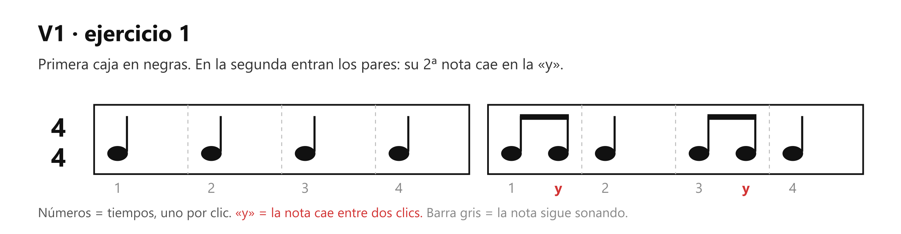
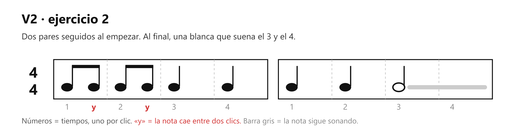
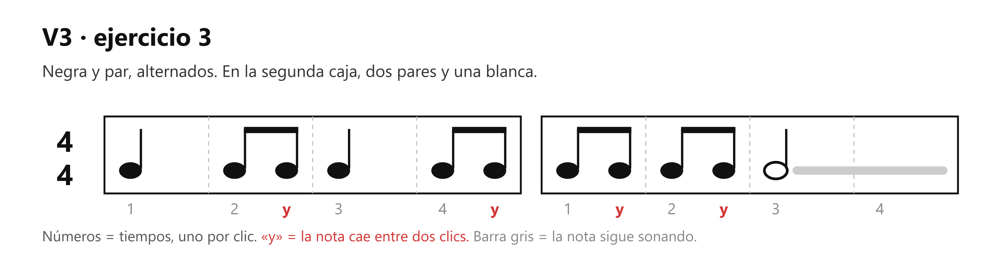
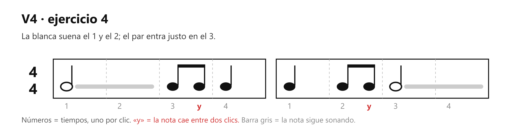
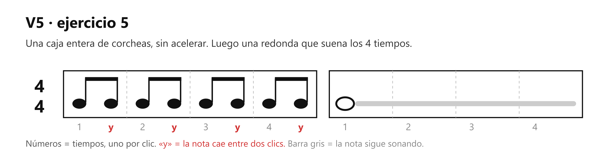
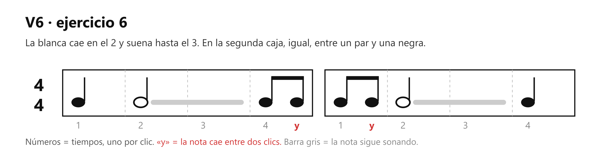
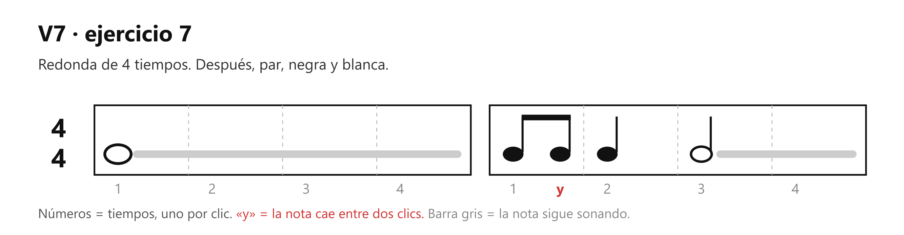
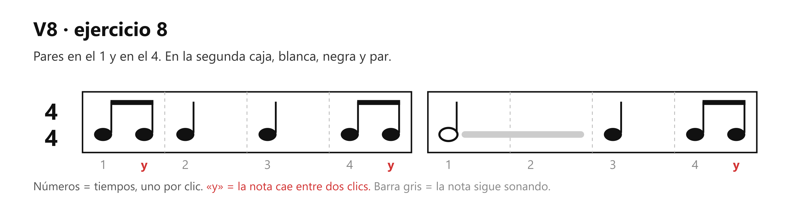
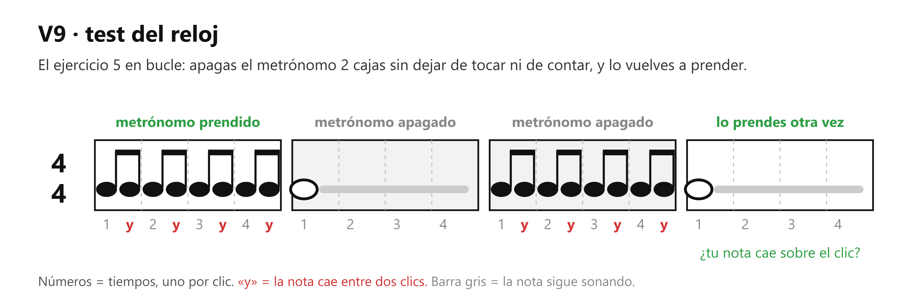

# 🎸 Práctica — Lectura rítmica con corcheas

> **Con la guitarra afinada y el metrónomo en 60.** Es la tarea de la clase 3: el profesor dibuja compases con figuras y tú los tocas a tiempo. Aquí tienes ocho del mismo tipo, ordenados de menos a más.

## 🎯 Qué estás mejorando (en claro)

**Leer un ritmo escrito y tocarlo a tiempo, con el pulso partido en dos.** Viene después de [Figuras con metrónomo](../clase01/clase01_practica_ritmo-metronomo.md): allá cada figura duraba tiempos enteros; aquí entra la corchea y tu mano tiene que caer también *entre* los clics.

En un par de corcheas, la primera nota va con el clic y la segunda en la «y», justo a la mitad, con la misma fuerza que la primera. Redondas, blancas y negras se tocan como siempre: en su número, y suenan lo que duran. Se toca en la 6ª cuerda al aire porque el ejercicio trabaja el tiempo y no los dedos.

**Lo vas a notar** cuando un compás nuevo del profesor te salga a la primera, sin descifrarlo nota por nota. Y cuando llegue el rasgueo (barrer varias cuerdas a la vez con la mano derecha), abajo-arriba, la «y» ya estará en tu mano.

## Cómo se hace (referencia)

Siempre: metrónomo en 60, la 6ª cuerda al aire y la cuenta en voz alta, «1 y 2 y 3 y 4 y». Antes de tocar cada versión, dila una vez sin guitarra. Las figuras están en [La corchea](clase03_la-corchea.md).

## ⏱️ Los 3 niveles del día — elige según cómo amaneciste

**Pon cronómetro. Cuando suena, paras.** Cada nivel incluye al anterior.

### 🔵 Mínimo — 5 min (día sin ganas; hecho esto, CUMPLISTE)

| Qué | Cuánto |
|---|---|
| V1, en bucle hasta que salga 2 veces seguidas | 1 min |
| V2, igual | 1 min |
| V3, igual | 1 min 30 s |
| V4, igual | 1 min 30 s |

El metrónomo va en todos los niveles, en 60.

### 🟢 Natural — 10 min (el día normal)

Todo el Mínimo, y además:

| Qué | Cuánto |
|---|---|
| V5, en bucle hasta que salga 2 veces seguidas | 1 min 30 s |
| V6, igual | 1 min 30 s |
| El ejercicio que peor salió hoy, solo, en bucle | 2 min |

### 🔥 Motivado — 15 min

Todo el Natural, y además:

| Qué | Cuánto |
|---|---|
| V7, en bucle hasta que salga 2 veces seguidas | 1 min 30 s |
| V8, igual | 1 min 30 s |
| V9, test del reloj | 2 min |

## Cómo suena cuando está bien

Las dos corcheas de cada par suenan iguales: mismo volumen, misma distancia. La primera cae junto con el clic y la «y» cae sola, en el medio exacto. Si el par suena cojo (larga-corta, como un galope), la «y» está llegando tarde.

## Si sale mal — los 3 típicos

| Pasa esto | Casi siempre es | Arréglalo así |
|---|---|---|
| **El par suena a galope** (larga-corta) | La «y» cae tarde, pegada al clic siguiente | Di la cuenta en voz alta sin tocar hasta que las sílabas salgan parejas; luego toca encima de tu propia voz |
| **Te aceleras en las corcheas** | Más notas se sienten como «más rápido» y el cuerpo se adelanta | Vuelve a un compás de solo negras hasta sentir el pulso y reintenta |
| **Te pierdes al cambiar de figura** | Lees la nota cuando ya hay que tocarla | Lee el compás completo en voz alta antes de tocarlo, con los ojos una caja adelante |

## Afinación del instructor

1. **Sin guitarra también sirve:** palmas con el metrónomo del celular, contando «1 y 2 y…». Dos minutos en el bus entrenan lo mismo.
2. **Escribe los tuyos:** dibuja en papel 2 o 3 compases que sumen 4, con corcheas, y tócalos. Si puedes escribir un ritmo, lo entiendes, y además tienes ejercicios nuevos del mismo tipo que los del profesor.

## Hasta cuándo / cuándo ya está

Era la tarea de la academia hasta la clase siguiente (martes 22-sep), y queda como práctica de lectura. **Está lista** cuando V7 y V8 salen a la primera, con el metrónomo en 60 y la cuenta en voz alta.

## Qué sigue

En el mapa: el rasgueo de M3 (3.3 a 3.6), con estas mismas corcheas en la mano derecha (abajo en el número, arriba en la «y»). Más adelante, M6: acentos (notas tocadas más fuerte que las demás), silencios y más patrones de rasgueo.
