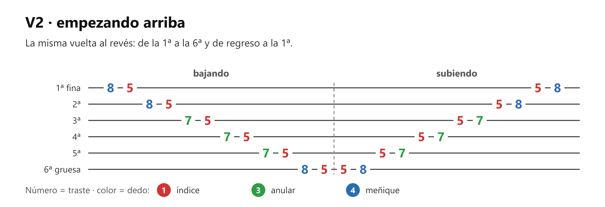
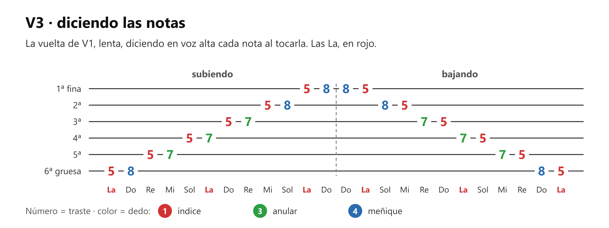

# 🎸 Práctica — La pentatónica de La menor, posición 1

> **Con la guitarra afinada.** Es lo que practicaron en la clase 3: subir y bajar la caja de los trastes 5-8. Si el profesor te indicó otra digitación o mano derecha, la suya manda.

## 🎯 Qué estás mejorando (en claro)

Trabajas las dos manos a la vez. **Mano izquierda:** la caja completa bajo los dedos, un dedo por traste, y el meñique (dedo 4) trabajando de verdad por primera vez. Pisa con la punta, cerca de la barrita metálica del traste. **Mano derecha:** tocar cuerdas de una en una y parejo, alternando índice y medio (lo natural en nylon) o como lo hizo el profesor. Es la base del picado y de los arpegios que la academia trae en las próximas clases (los dos términos están definidos en [el apunte](clase03_la-pentatonica.md)).

**Lo vas a notar** cuando subas y bajes sin mirar la imagen y sin tropezar al cambiar de cuerda.

## Cómo se hace (referencia)

Siempre: la mano izquierda quieta en la caja, con el dedo 1 en el traste 5. Con metrónomo, una nota por clic.

## ⏱️ Los 3 niveles del día — elige según cómo amaneciste

**Pon cronómetro. Cuando suena, paras.** Cada nivel incluye al anterior.

### 🔵 Mínimo — 5 min (día sin ganas; hecho esto, CUMPLISTE)

| Qué | Cuánto |
|---|---|
| V1, lenta, mirando la imagen, sin metrónomo, cuidando que cada nota suene limpia | 2 min |
| V1, metrónomo 60, mirando la imagen solo si te pierdes | 3 min |

### 🟢 Natural — 8 min (el día normal)

Todo el Mínimo, y además:

| Qué | Cuánto |
|---|---|
| V1, sin mirar la imagen, metrónomo 60 | 2 min |
| V2, la primera vuelta lenta y sin metrónomo, después con metrónomo 60 | 1 min |

Si te pierdes sin mirar, termina la vuelta como salga y compruébala al final (ver Verificación).

### 🔥 Motivado — 12 min

Todo el Natural, y además:

| Qué | Cuánto |
|---|---|
| V1, metrónomo 70 | 2 min |
| V3, lenta, sin metrónomo | 2 min |

## Cómo suena cuando está bien

Una escalera pareja: todas las notas al mismo volumen y a la misma distancia, sin hueco al cambiar de cuerda. La nota del meñique suena igual de firme que la del índice. Cada nota suena limpia hasta que llega la siguiente, sin cortarse antes.

## Si sale mal — los 3 típicos

| Pasa esto | Casi siempre es | Arréglalo así |
|---|---|---|
| **La nota del dedo 4 zumba o sale débil** | El meñique pisa plano o lejos del traste metálico | Punta del dedo, pegada a la barrita. Es el dedo más débil y necesita firmeza, sin forzar |
| **Tropiezas al cambiar de cuerda** | La mano derecha no encuentra la cuerda nueva | Quita el metrónomo y haz ese cambio lento 3 veces y vuelve a ponerlo |
| **Los dedos «vuelan» al soltar** | Tensión: cada dedo se aleja de la cuerda | Suéltalos a ras de cuerda. Menos distancia que recorrer = menos esfuerzo y más velocidad |

## Hasta cuándo / cuándo ya está

Era la tarea de la academia hasta la clase siguiente (martes 22-sep), y queda como práctica de la caja. **Está lista** cuando haces V1 sin mirar, con metrónomo en 60 y sin tropiezos, dos días seguidos.

## Qué sigue

En la academia: picado y arpegios (módulo II del sílabo, clases 5-8; definidos en [el apunte](clase03_la-pentatonica.md)), y esta caja es donde se practican. En el mapa: M8.6 (escalas como mapa del mástil), que quedará medio andada.

## Verificación — mirar después de intentar

Después de las vueltas sin mirar, abre el diagrama y comprueba: ¿usaste el traste 7 en las cuerdas 5ª, 4ª y 3ª, y el 8 en la 6ª, la 2ª y la 1ª? ¿El dedo 1 se quedó siempre en el traste 5?

