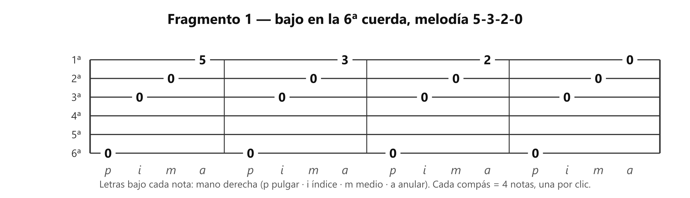
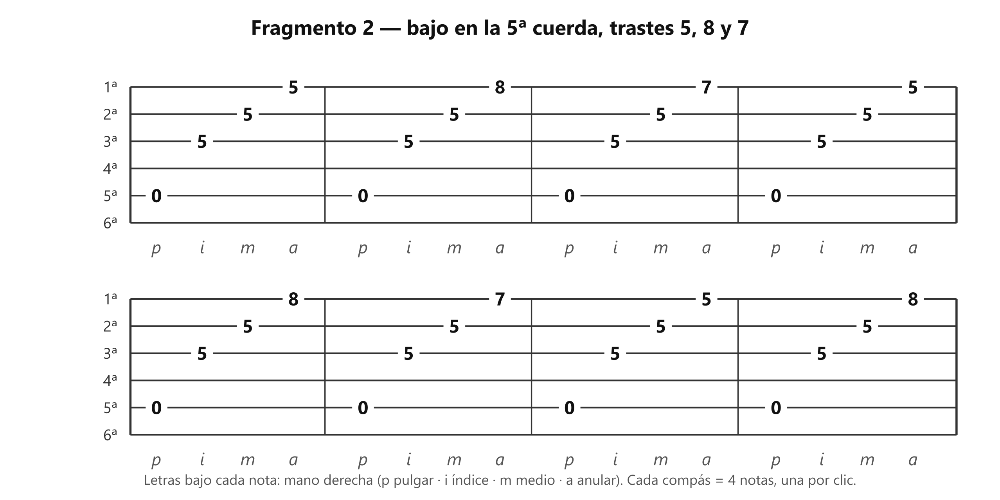
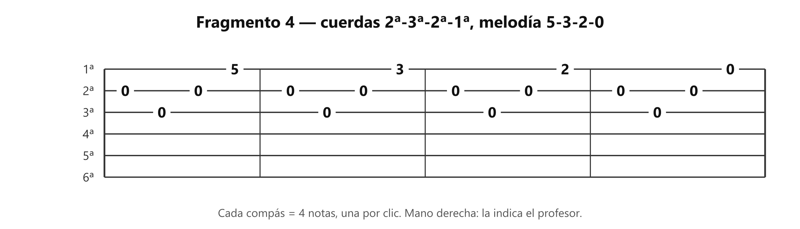
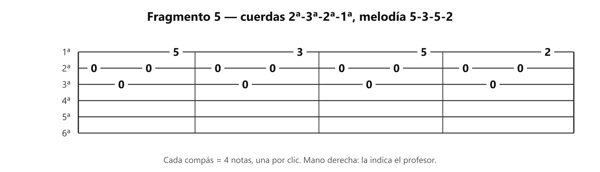

# 🎸 Práctica — Arpegio: 5 fragmentos con metrónomo

> **Con la guitarra afinada.** Es lo que practicaron en las clases 7 y 8: cinco fragmentos de arpegio que el profesor pasó en TAB, tocados cada uno con el metrónomo subiendo de velocidad. Su corrección manda sobre cualquier cosa de aquí: **dedos de la mano derecha pegados a la cuerda, sin levantarlos de más.**

## 🎯 Qué estás mejorando (en claro)

La **mano derecha**. Un **arpegio** es tocar las cuerdas de una en una, en vez de todas juntas como en un rasgueo. Cada dedo de la mano derecha tiene su letra: **p** pulgar, **i** índice, **m** medio, **a** anular (**p-i-m-a**). El pulgar toca el bajo (la cuerda grave) y los otros tres tocan las cuerdas agudas. Lo que se entrena: que cada dedo vaya a su cuerda sin pensar y que las notas salgan parejas. Lo notarás cuando un compás salga limpio varias veces seguidas, también después de subir el metrónomo.

## El gráfico

Los 5 fragmentos tal como los pasó el profesor. Cada compás tiene 4 notas, una por clic.

*Fragmento 1: bajo en la 6ª cuerda; la 1ª cuerda cambia de traste en cada compás (5, 3, 2, 0).*

*Fragmento 2: bajo en la 5ª cuerda; las cuerdas 3ª y 2ª quedan quietas en el traste 5 y solo cambia la 1ª (5, 8, 7).*

*Fragmento 3: igual que el 1, con otra melodía en la 1ª cuerda (5, 3, 5, 2).*

*Fragmento 4: sin bajo; el compás va 2ª, 3ª, 2ª, 1ª cuerda (5, 3, 2, 0).*

*Fragmento 5: igual que el 4, con la melodía 5, 3, 5, 2.*

## Cómo se hace (referencia)

- **Un compás = 4 notas = 4 clics del metrónomo,** una nota por clic. Al terminar el compás, sigue al siguiente sin parar (el [metrónomo y el 4/4](../clase01/clase01_ritmo-basico.md) están explicados en la clase 1).
- **Mano derecha en los fragmentos 1, 2 y 3:** p toca el bajo, i la 3ª cuerda, m la 2ª y a la 1ª. En el 4 y el 5 no hay bajo y el compás va 2ª, 3ª, 2ª, 1ª: propuesta m, i, m, a (sin pulgar). Si el profesor indicó otra, la suya manda.
- **Mano izquierda (propuesta; si el profesor te indicó otra, la suya manda):** un dedo por traste. En los fragmentos 1, 3, 4 y 5 la 1ª cuerda usa el traste 2 con el dedo 1, el 3 con el dedo 2 y el 5 con el dedo 4. En el fragmento 2, el dedo 1 pisa el traste 5 en las tres cuerdas a la vez (la 3ª, la 2ª y la 1ª), con el dedo tendido sobre ellas, y deja libre el 7 para el dedo 3 y el 8 para el dedo 4.
- **Cómo se sube el metrónomo:** empieza en 60. Subes a la velocidad siguiente (70, luego 80) solo cuando el fragmento te salió limpio dos veces seguidas en la actual.
- **Si un compás tropieza,** repítelo solo 4 veces antes de volver al fragmento completo.

## ⏱️ Los 3 niveles del día — elige según cómo amaneciste

**Pon cronómetro. Cuando suena, paras.** Cada nivel incluye al anterior.

### 🔵 Mínimo — 5 min (día sin ganas; hecho esto, CUMPLISTE)

| Qué | Cuánto |
|---|---|
| Los fragmentos 1, 2, 3, 4 y 5, uno tras otro, en metrónomo 60 y mirando la TAB | 1 min cada uno |

Metrónomo: sí, en 60.

### 🟢 Natural — 10 min (el día normal)

Todo el Mínimo, y además:

| Qué | Cuánto |
|---|---|
| Los fragmentos 1, 2, 3, 4 y 5 otra vez, en metrónomo 70 | 1 min cada uno |

Metrónomo: sí, en 60 y en 70.

### 🔥 Motivado — 15 min

Todo el Natural, y además:

| Qué | Cuánto |
|---|---|
| Los fragmentos 1, 2 y 3 en metrónomo 80 | 1 min cada uno |
| Los fragmentos 1 y 4 en metrónomo 60, **sin mirar la TAB** (si te pierdes, termina el compás como salga y verifica al final) | 1 min cada uno |

Metrónomo: sí, en 60, 70 y 80.

## Cómo suena cuando está bien

Las cuatro notas de cada compás suenan al mismo volumen y a la misma distancia una de otra, cada una cae sobre su clic. Ninguna nota se corta antes de que llegue la siguiente. La nota de la 1ª cuerda (la que cambia de traste) se oye clara, sin quedar tapada por las otras. Al subir el metrónomo, el compás no se aprieta ni se atrasa.

## Si sale mal — los 3 típicos

| Pasa esto | Casi siempre es | Arréglalo así |
|---|---|---|
| **Los dedos de la derecha se levantan mucho entre nota y nota** | Cada dedo se dispara lejos de la cuerda | Es la corrección del profesor: deja cada dedo pegado a su cuerda después de tocarla. Menos recorrido = menos tiempo por nota |
| **La nota de la 1ª cuerda sale floja o llega tarde** | El dedo a (anular) suele ser el más débil de la mano derecha | Quita el bajo y toca solo i-m-a, lento, 4 compases. Luego vuelve a poner el bajo |
| **Al subir el metrónomo se pierde el clic** | Se subió antes de que el compás saliera limpio | Baja 10 puntos del metrónomo (por ejemplo, de 70 a 60). Sube de nuevo cuando el fragmento salga limpio dos veces seguidas |

## Hasta cuándo / cuándo ya está

Es tarea de la academia: hasta la próxima clase (martes 27-oct). **Está lista** cuando cada fragmento sale limpio, con la TAB delante, a 70, en 4 compases seguidos, dos días seguidos; y los fragmentos 1 y 4 también sin mirarla, a 60. Si en clase el profesor llegó a una velocidad mayor, esa es tu meta.

## Qué sigue

El apunte de **p-i-m-a** (concepto 8 de la cola) y después el **arpegio sobre acordes** (concepto 9). En el mapa: M8, mano derecha.

## Verificación — mirar después de intentar

Tras tocar sin mirar, abre la TAB y comprueba: ¿la 1ª cuerda cambió de traste en cada compás, en el orden de la TAB? ¿Tocaste el fragmento 2 con las cuerdas 3ª y 2ª fijas en el traste 5?
